# Peerly data model (ERD and data dictionary)

This document covers requirement OR-27 (ERD). The schema is the result of applying every migration in `server/migrations/`, in filename order:

| Migration | What it adds |
| --- | --- |
| `0001_init.sql` | Enumerations and the core tables, the business-rule constraints, and the append-only audit trigger |
| `0002_verification_lockout_export.sql` | `email_verification_codes`, `login_attempts`, `assessments.exported_at`, and the nine-point rating scale (seed data) |
| `0003_full_precision_results.sql` | Widens four `calculated_results` columns from `numeric(8,4)` to unconstrained `numeric`, so intermediate figures keep full precision (FR-22) |
| `0004_banded_rating_scale.sql` | Sets the rating options to the banded scale agreed on 2026-09-22 (Excellent 100 down to No contribution 59), the top of each band |

`server/src/db/migrate.ts` also creates `schema_migrations`, its own bookkeeping table. Including that table, the database has **20 tables**: 19 from the migrations plus `schema_migrations`.

Migrations are immutable once applied. The runner stores each file's SHA-256 checksum and refuses to continue if an applied file has changed. To change the schema, add `0004_...sql` (see [technical-handover.md → Maintenance](./technical-handover.md#77-changing-the-database-schema)).

## Entity-relationship diagram

In the diagram, solid lines are foreign keys that the database enforces. Dotted lines are logical references that have **no** foreign key on purpose. For example, `audit_entries` must outlive whatever it describes.

```mermaid
erDiagram
    users {
        uuid id PK
        user_role role
        text name
        text surname
        text email UK "unique on lower(email)"
        text student_number UK "unique when not null"
        text password_hash "bcrypt, null until activated"
        user_status status
        timestamptz created_at
        timestamptz updated_at
    }
    sessions {
        uuid id PK
        text token_hash UK "SHA-256 of cookie token"
        uuid user_id FK
        timestamptz created_at
        timestamptz last_seen_at
        timestamptz expires_at
        timestamptz revoked_at
        text user_agent
        inet ip
    }
    auth_tokens {
        uuid id PK
        uuid user_id FK
        token_purpose purpose
        text token_hash UK
        timestamptz expires_at
        timestamptz consumed_at
        timestamptz created_at
    }
    email_verification_codes {
        uuid id PK
        uuid user_id FK
        text email
        text code_hash
        timestamptz expires_at
        timestamptz consumed_at
        int attempts
        timestamptz created_at
    }
    login_attempts {
        bigint id PK
        text email
        uuid user_id "no FK"
        boolean succeeded
        inet ip
        text user_agent
        timestamptz attempted_at
    }
    classes {
        uuid id PK
        text module_code
        text name
        text academic_period
        uuid lecturer_id FK
        timestamptz created_at
    }
    enrolments {
        uuid id PK
        uuid class_id FK
        text student_number
        text imported_name
        text imported_surname
        text imported_email
        match_status match_status
        uuid user_id FK "null unless matched"
        text match_note
        timestamptz created_at
    }
    groups {
        uuid id PK
        uuid class_id FK
        int group_number
        timestamptz created_at
    }
    group_members {
        uuid group_id PK,FK
        uuid student_id PK,FK
        uuid class_id FK
        timestamptz added_at
    }
    assessments {
        uuid id PK
        uuid class_id FK
        text name
        text description
        assessment_status status
        timestamptz opens_at
        timestamptz closes_at
        numeric max_mark "numeric(6,2)"
        timestamptz calculated_at
        uuid calculation_run_id "no FK"
        uuid created_by FK
        timestamptz created_at
        timestamptz exported_at
    }
    assessment_groups {
        uuid assessment_id PK,FK
        uuid group_id PK,FK
        uuid class_id FK
    }
    rating_options {
        uuid id PK
        text label UK
        text description
        numeric hidden_value "numeric(6,3), never sent to students"
        int display_order UK
        boolean active
    }
    submissions {
        uuid id PK
        uuid assessment_id FK
        uuid evaluator_id FK
        submission_status status
        timestamptz submitted_at
        timestamptz created_at
        timestamptz updated_at
    }
    peer_ratings {
        uuid id PK
        uuid submission_id FK
        uuid assessment_id FK
        uuid group_id FK
        uuid evaluator_id FK
        uuid evaluated_id FK
        uuid rating_option_id FK
        text comment "max 500 chars"
        timestamptz created_at
    }
    group_marks {
        uuid assessment_id PK,FK
        uuid group_id PK,FK
        numeric base_mark "numeric(6,2), null = not entered"
        uuid entered_by FK
        timestamptz updated_at
    }
    calculation_runs {
        uuid id PK
        uuid assessment_id FK
        uuid run_by FK
        text rule_version
        jsonb config "frozen CalculationConfig"
        timestamptz created_at
    }
    calculated_results {
        uuid id PK
        uuid run_id FK
        uuid assessment_id FK
        uuid student_id FK
        uuid group_id FK
        int ratings_received
        numeric mean_received
        numeric group_mean
        numeric raw_factor
        numeric adjustment_factor
        numeric base_mark "numeric(6,2)"
        numeric final_mark "numeric(6,2)"
        text_array flags "text[]"
    }
    mark_overrides {
        uuid id PK
        uuid assessment_id FK
        uuid student_id FK
        numeric calculated_mark "numeric(6,2)"
        numeric override_mark "numeric(6,2)"
        text reason "mandatory"
        uuid overridden_by FK
        timestamptz created_at
    }
    audit_entries {
        bigint id PK
        timestamptz occurred_at
        uuid actor_id "no FK"
        text actor_name
        user_role actor_role
        text event_type
        text object_description
        text detail
        uuid class_id "no FK"
        uuid assessment_id "no FK"
        jsonb before_state
        jsonb after_state
    }
    schema_migrations {
        text version PK
        text checksum
        timestamptz applied_at
    }

    users ||--o{ sessions : "signs in with"
    users ||--o{ auth_tokens : "activation / recovery"
    users ||--o{ email_verification_codes : "verifies with"
    users ||--o{ classes : "owns (lecturer_id)"
    classes ||--o{ enrolments : "class list"
    users |o--o{ enrolments : "matched account"
    classes ||--o{ groups : "has"
    groups ||--o{ group_members : "members"
    classes ||--o{ group_members : "scopes (BR-10)"
    users ||--o{ group_members : "student"
    classes ||--o{ assessments : "has"
    users |o--o{ assessments : "created_by"
    assessments ||--o{ assessment_groups : "takes part"
    groups ||--o{ assessment_groups : "takes part"
    classes ||--o{ assessment_groups : "same class"
    assessments ||--o{ submissions : "receives"
    users ||--o{ submissions : "evaluator"
    submissions ||--o{ peer_ratings : "contains"
    group_members ||--o{ peer_ratings : "evaluator in group (BR-01)"
    group_members ||--o{ peer_ratings : "evaluated in group (BR-01)"
    rating_options ||--o{ peer_ratings : "chosen option"
    assessments ||--o{ group_marks : "base marks"
    groups ||--o{ group_marks : "base mark for"
    users |o--o{ group_marks : "entered_by"
    assessments ||--o{ calculation_runs : "calculated by"
    users ||--o{ calculation_runs : "run_by"
    calculation_runs ||--o{ calculated_results : "produced"
    assessments ||--o{ calculated_results : "current results"
    users ||--o{ calculated_results : "student"
    groups ||--o{ calculated_results : "group"
    assessments ||--o{ mark_overrides : "overrides"
    users ||--o{ mark_overrides : "student / overridden_by"
    assessments }o..o| calculation_runs : "calculation_run_id (no FK)"
    users |o..o{ audit_entries : "actor_id (no FK)"
    users |o..o{ login_attempts : "user_id (no FK)"
```

`peer_ratings` also has plain foreign keys from `evaluator_id` and `evaluated_id` to `users`, and a composite foreign key `(submission_id, assessment_id)` to `submissions`. The diagram leaves some of these out to stay readable. The data dictionary below lists every one.

---

## Enumerated types

| Type | Values |
| --- | --- |
| `user_role` | `admin`, `lecturer`, `student` |
| `user_status` | `active`, `inactive`, `unverified` |
| `match_status` | `matched`, `unmatched`, `conflict` |
| `assessment_status` | `draft`, `open`, `closed` |
| `submission_status` | `draft`, `submitted` |
| `token_purpose` | `activation`, `recovery` |

To add a value to an enum, write a migration with `ALTER TYPE ... ADD VALUE`. PostgreSQL does not allow the new value to be used in the same transaction that adds it. The migration runner wraps each file in a transaction, so put the `ADD VALUE` in a file of its own.

---

## Data dictionary

Unless a column says otherwise, it is `NOT NULL`. "FK → x (cascade)" means `ON DELETE CASCADE`. "FK → x" with nothing after it means PostgreSQL's default `NO ACTION`: the parent row cannot be deleted while children exist.

### `users`

This table holds every account: administrators, lecturers and students (FR-01, FR-02).

| Column | Type | Constraint | Meaning |
| --- | --- | --- | --- |
| `id` | uuid | PK, default `gen_random_uuid()` | |
| `role` | user_role | | The role is fixed per account. Registration always creates `student`, and only an administrator can create `admin` or `lecturer` accounts (BR-13). |
| `name`, `surname` | text | `CHECK (btrim(x) <> '')` | |
| `email` | text | unique index `users_email_lower_key` on `lower(email)` | The sign-in identifier, matched without regard to case |
| `student_number` | text | nullable. Partial unique index `users_student_number_key`. `CHECK students_have_a_student_number` | 8 digits. Required for students (AS-01), used to match class lists (FR-04) |
| `password_hash` | text | nullable | bcrypt at cost 12. `NULL` until the holder sets a password. Nobody else ever sets one. |
| `status` | user_status | default `unverified` | Only `active` accounts can sign in or hold a session (BR-12). Deactivation sets `inactive` and deletes nothing (BR-14). |
| `created_at`, `updated_at` | timestamptz | default `now()` | |

### `sessions`

Server-side sessions (SR-05, SI-07, CI-08).

| Column | Type | Constraint | Meaning |
| --- | --- | --- | --- |
| `id` | uuid | PK | |
| `token_hash` | text | UNIQUE | SHA-256 of the cookie token. The token itself is never stored. |
| `user_id` | uuid | FK → users (cascade) | |
| `created_at` | timestamptz | | |
| `last_seen_at` | timestamptz | | Drives idle expiry (`SESSION_IDLE_MINUTES`). Refreshed at most every 30 seconds. |
| `expires_at` | timestamptz | | Absolute expiry (`SESSION_ABSOLUTE_MINUTES`), never extended |
| `revoked_at` | timestamptz | nullable | Set by sign-out, password change or reset, and deactivation |
| `user_agent`, `ip` | text, inet | nullable | Where the session was opened |

Index: `sessions_user_id_idx (user_id) WHERE revoked_at IS NULL`.

### `auth_tokens`

Staff activation links and password-reset links (FR-03, FR-06).

| Column | Type | Constraint | Meaning |
| --- | --- | --- | --- |
| `id` | uuid | PK | |
| `user_id` | uuid | FK → users (cascade) | |
| `purpose` | token_purpose | | `activation` or `recovery` |
| `token_hash` | text | UNIQUE | SHA-256 of the 32-byte base64url token sent in the e-mail |
| `expires_at` | timestamptz | | `ACTIVATION_TOKEN_MINUTES` or `RECOVERY_TOKEN_MINUTES` after issue |
| `consumed_at` | timestamptz | nullable | Set when the token is used, or when a newer token for the same purpose replaces it |
| `created_at` | timestamptz | | |

Index: `auth_tokens_user_purpose_idx (user_id, purpose) WHERE consumed_at IS NULL`.

### `email_verification_codes` (0002)

The 6-digit codes students use to prove their e-mail address at registration (FR-02, FR-03, SR-01).

| Column | Type | Constraint | Meaning |
| --- | --- | --- | --- |
| `id` | uuid | PK | |
| `user_id` | uuid | FK → users (cascade) | |
| `email` | text | | Lower-cased address the code was sent to |
| `code_hash` | text | | SHA-256 of the code |
| `expires_at` | timestamptz | | `EMAIL_CODE_MINUTES` after issue (default 10) |
| `consumed_at` | timestamptz | nullable | Set on success, on expiry or after too many attempts, and when a resend replaces the code |
| `attempts` | int | `CHECK (attempts >= 0)`, default 0 | Wrong guesses so far. At 5 the code is spent. |
| `created_at` | timestamptz | | |

Index: **`email_verification_codes_one_live_per_user`**, a unique index on `(user_id) WHERE consumed_at IS NULL`, so at most one code per account is live at any time (OR-07).

### `login_attempts` (0002)

Every sign-in attempt. The lock-out (SR-04) is derived from this table instead of from a counter.

| Column | Type | Constraint | Meaning |
| --- | --- | --- | --- |
| `id` | bigserial | PK | |
| `email` | text | | Lower-cased address that was tried. It does not have to belong to an account. |
| `user_id` | uuid | nullable, **no FK** | The account, if one exists |
| `succeeded` | boolean | | |
| `ip`, `user_agent` | inet, text | nullable | |
| `attempted_at` | timestamptz | default `now()` | |

Indexes: `login_attempts_email_idx (email, attempted_at DESC)` and `login_attempts_ip_idx (ip, attempted_at DESC) WHERE ip IS NOT NULL`.

The table grows without limit. See [technical-handover.md → Housekeeping](./technical-handover.md#78-housekeeping).

### `classes`

A module offering, owned by one lecturer (BR-11).

| Column | Type | Constraint | Meaning |
| --- | --- | --- | --- |
| `id` | uuid | PK | |
| `module_code` | text | `CHECK (btrim <> '')` | Stored in upper case, for example `CMPG323` |
| `name` | text | `CHECK (btrim <> '')` | |
| `academic_period` | text | | Free text, for example `2026 Semester 2` |
| `lecturer_id` | uuid | FK → users | The owner. No cascade: a lecturer who owns classes cannot be deleted, and no route deletes users. |
| `created_at` | timestamptz | | |

Constraint: `UNIQUE (module_code, academic_period)`. Index: `classes_lecturer_idx`.

### `enrolments`

One row per student on an imported class list (FR-08, FR-09, FR-04).

| Column | Type | Constraint | Meaning |
| --- | --- | --- | --- |
| `id` | uuid | PK | |
| `class_id` | uuid | FK → classes (cascade) | |
| `student_number` | text | | As imported. The upload is checked for 8 digits before the row is stored. |
| `imported_name`, `imported_surname` | text | | As imported |
| `imported_email` | text | nullable | As imported, if the file had an e-mail column mapped |
| `match_status` | match_status | default `unmatched` | `matched` means linked to an account. `unmatched` means no account yet. `conflict` means a lecturer must resolve it. |
| `user_id` | uuid | nullable, FK → users (set null) | The matched student account |
| `match_note` | text | nullable | An explanation shown to the lecturer and the student |
| `created_at` | timestamptz | | |

Constraints: `UNIQUE (class_id, student_number)`, so a student number appears at most once per list (FR-08). **`matched_enrolments_have_an_account`**: `CHECK (match_status <> 'matched' OR user_id IS NOT NULL)`. **`enrolments_one_account_per_class`**: a unique index on `(class_id, user_id) WHERE user_id IS NOT NULL`, so one account cannot hold two rows in the same class.

### `groups`

| Column | Type | Constraint | Meaning |
| --- | --- | --- | --- |
| `id` | uuid | PK | |
| `class_id` | uuid | FK → classes (cascade) | |
| `group_number` | int | `CHECK (> 0)` | The number shown to users |
| `created_at` | timestamptz | | |

Constraints: `UNIQUE (class_id, group_number)`, and `UNIQUE (id, class_id)`, which exists so that composite foreign keys can reference it.

### `group_members`

| Column | Type | Constraint | Meaning |
| --- | --- | --- | --- |
| `group_id` | uuid | PK part. FK `(group_id, class_id)` → groups (cascade) | |
| `student_id` | uuid | PK part. FK → users (cascade) | |
| `class_id` | uuid | FK → classes (cascade) | Denormalised on purpose so that BR-10 can be a constraint |
| `added_at` | timestamptz | | |

Constraints: **`UNIQUE (class_id, student_id)`** means a student is in at most one group per class (BR-10). The composite FK means the member's class must be the group's class.

### `assessments`

| Column | Type | Constraint | Meaning |
| --- | --- | --- | --- |
| `id` | uuid | PK | |
| `class_id` | uuid | FK → classes (cascade) | |
| `name` | text | `CHECK (btrim <> '')` | |
| `description` | text | default `''` | |
| `status` | assessment_status | default `draft` | Moves `draft → open → closed`, and `closed → open` on re-opening. The API enforces the transitions. |
| `opens_at`, `closes_at` | timestamptz | **`CHECK closes_after_it_opens (closes_at > opens_at)`** | The open and close times are informational. Status only changes when the lecturer acts. Nothing opens or closes automatically at these times. |
| `max_mark` | numeric(6,2) | `CHECK (> 0)`, default 100 | Upper bound for base marks and overrides |
| `calculated_at` | timestamptz | nullable | Time of the latest calculation. Cleared when the assessment is re-opened. |
| `calculation_run_id` | uuid | nullable, **no FK** | The latest `calculation_runs.id` |
| `created_by` | uuid | nullable, FK → users | |
| `created_at` | timestamptz | | |
| `exported_at` | timestamptz | nullable (0002) | Time of the latest results export. The deletion confirmation reads it (FR-28). |

Constraint: `UNIQUE (id, class_id)`, used by the composite FKs. Index: `assessments_class_idx`.

### `assessment_groups`

The groups of the class that take part in an assessment (FR-12).

| Column | Type | Constraint | Meaning |
| --- | --- | --- | --- |
| `assessment_id` | uuid | PK part. FK `(assessment_id, class_id)` → assessments (cascade) | |
| `group_id` | uuid | PK part. FK `(group_id, class_id)` → groups (cascade) | |
| `class_id` | uuid | FK → classes (cascade) | Makes both FKs point at the **same** class, so an assessment cannot include another class's group |

### `rating_options`

The descriptive rating scale. It is reference data (OR-19), seeded by migration 0002.

| Column | Type | Constraint | Meaning |
| --- | --- | --- | --- |
| `id` | uuid | PK | |
| `label` | text | UNIQUE | What the student sees, for example "Very good" |
| `description` | text | | The explanation shown to the student |
| `hidden_value` | numeric(6,3) | | The numeric value the calculation uses. **It must never reach a student** (BR-15, SR-08). The API removes it. |
| `display_order` | int | UNIQUE | Order on screen. 1 is the best option. |
| `active` | boolean | default true | Inactive options are not offered. Rows that have been used cannot be deleted, because `peer_ratings` references them without a cascade. Deactivate them instead. |

Values: Excellent 100, Very good 94, Satisfactory 89, Ordinary 84, Marginal 79, Deficient 74, Unsatisfactory 69, Superficial 64, No contribution 59. Each is the top of a band of marks (95-100, 90-94 … 50-59). Seeded by 0002 on a 0-100 scale, and set to these values by 0004.

### `submissions`

One row per evaluator per assessment. The row starts as a draft (autosave) and becomes `submitted`.

| Column | Type | Constraint | Meaning |
| --- | --- | --- | --- |
| `id` | uuid | PK | |
| `assessment_id` | uuid | FK → assessments (cascade) | |
| `evaluator_id` | uuid | FK → users (cascade) | The student submitting |
| `status` | submission_status | default `draft` | |
| `submitted_at` | timestamptz | nullable. **`CHECK submitted_rows_have_a_timestamp`** | Time of the first submission. It is kept when the evaluation is amended. |
| `created_at`, `updated_at` | timestamptz | | |

Constraints: **`UNIQUE (assessment_id, evaluator_id)`** means one submission per evaluator, and an amendment replaces the previous one (BR-03). `UNIQUE (id, assessment_id)` exists for the composite FK from `peer_ratings`.

### `peer_ratings`

One row per rating a student gives a group member. Rows exist for drafts as well as submissions.

| Column | Type | Constraint | Meaning |
| --- | --- | --- | --- |
| `id` | uuid | PK | |
| `submission_id` | uuid | FK `(submission_id, assessment_id)` → submissions (cascade) | |
| `assessment_id` | uuid | | |
| `group_id` | uuid | part of the two composite FKs below | |
| `evaluator_id` | uuid | FK → users (cascade). **FK `evaluator_is_in_the_group` `(group_id, evaluator_id)` → group_members (cascade)** | |
| `evaluated_id` | uuid | FK → users (cascade). **FK `evaluated_is_in_the_group` `(group_id, evaluated_id)` → group_members (cascade)** | |
| `rating_option_id` | uuid | FK → rating_options | |
| `comment` | text | nullable. `CHECK (char_length <= 500)` | FR-17 |
| `created_at` | timestamptz | | |

Constraints: **`no_self_evaluation`**: `CHECK (evaluator_id <> evaluated_id)` (BR-02). **`UNIQUE (assessment_id, evaluator_id, evaluated_id)`** (BR-03). The two group-membership FKs (BR-01). Indexes: `peer_ratings_assessment_idx` and `peer_ratings_evaluated_idx (assessment_id, evaluated_id)`.

### `group_marks`

The lecturer's base mark for each participating group (FR-21).

| Column | Type | Constraint | Meaning |
| --- | --- | --- | --- |
| `assessment_id` | uuid | PK part. FK → assessments (cascade) | |
| `group_id` | uuid | PK part. FK → groups (cascade) | |
| `base_mark` | numeric(6,2) | nullable. `CHECK (NULL or >= 0)` | `NULL` means not entered, which is different from 0. The API also checks the mark against `max_mark`. |
| `entered_by` | uuid | nullable, FK → users | |
| `updated_at` | timestamptz | | |

### `calculation_runs`

Each run of the Felder calculation is kept as a permanent record (OR-09).

| Column | Type | Constraint | Meaning |
| --- | --- | --- | --- |
| `id` | uuid | PK | |
| `assessment_id` | uuid | FK → assessments (cascade) | |
| `run_by` | uuid | FK → users | The lecturer who ran the calculation |
| `rule_version` | text | | `CalculationConfig.ruleVersion`, for example `felder-2026.3-provisional` |
| `config` | jsonb | | **The complete `CalculationConfig` in force for this run**: factor limits, rounding, neutral factor and flag thresholds. It is frozen at run time, so an old mark can still be explained after the configuration in `server/src/lib/felder.ts` changes (OR-09, OR-19). |
| `created_at` | timestamptz | | |

Index: `calculation_runs_assessment_idx (assessment_id, created_at DESC)`. Earlier runs are kept after a recalculation. Only `calculated_results` is replaced.

### `calculated_results`

The current results for each assessment, one row per student.

| Column | Type | Constraint | Meaning |
| --- | --- | --- | --- |
| `id` | uuid | PK | |
| `run_id` | uuid | FK → calculation_runs (cascade) | The run that produced the row |
| `assessment_id` | uuid | FK → assessments (cascade) | |
| `student_id` | uuid | FK → users | |
| `group_id` | uuid | FK → groups | No cascade. See the note on regrouping below. |
| `ratings_received` | int | default 0 | Number of *submitted* ratings counted |
| `mean_received` | numeric (0003) | nullable | The student's mean received rating, at full precision |
| `group_mean` | numeric (0003) | nullable | |
| `raw_factor` | numeric (0003) | nullable | `mean_received / group_mean` before clamping |
| `adjustment_factor` | numeric (0003) | nullable | After clamping to `[minFactor, maxFactor]` |
| `base_mark` | numeric(6,2) | nullable | The group mark used |
| `final_mark` | numeric(6,2) | nullable | `base_mark × adjustment_factor`, rounded once to `roundTo` places (BR-07) |
| `flags` | text[] | default `'{}'` | Advisory flags for review (FR-20, FR-23). They never change the mark. |

Constraint: `UNIQUE (run_id, student_id)`. Index: `calculated_results_assessment_idx`.

### `mark_overrides`

| Column | Type | Constraint | Meaning |
| --- | --- | --- | --- |
| `id` | uuid | PK | |
| `assessment_id` | uuid | FK → assessments (cascade) | |
| `student_id` | uuid | FK → users | |
| `calculated_mark` | numeric(6,2) | | The calculated mark at the time of the override. It is kept and never replaced (BR-08). |
| `override_mark` | numeric(6,2) | `CHECK (>= 0)` | The API also checks it against `max_mark` |
| `reason` | text | **`CHECK (char_length(btrim(reason)) > 0)`** | Mandatory (FR-24) |
| `overridden_by` | uuid | FK → users | |
| `created_at` | timestamptz | | Updated when the override is replaced |

Constraint: `UNIQUE (assessment_id, student_id)`, so a new override replaces the old one. The audit log keeps the history.

### `audit_entries`

The append-only audit trail (FR-27, SR-15, OR-09).

| Column | Type | Constraint | Meaning |
| --- | --- | --- | --- |
| `id` | bigserial | PK | |
| `occurred_at` | timestamptz | default `now()` | |
| `actor_id` | uuid | nullable, **no FK** | |
| `actor_name` | text | | The actor's name *at the time*, or `System` |
| `actor_role` | user_role | nullable | |
| `event_type` | text | | See the event types in [api.md](./api.md#audit-log-apiaudit) |
| `object_description` | text | | A readable description of the object |
| `detail` | text | default `''` | |
| `class_id`, `assessment_id` | uuid | nullable, **no FK** | Scope the lecturer's view. They survive when the class or assessment is deleted. |
| `before_state`, `after_state` | jsonb | nullable | The relevant values before and after the change |

Indexes: `audit_entries_occurred_idx (occurred_at DESC)` and `audit_entries_class_idx (class_id, occurred_at DESC)`.

### `schema_migrations`

Created by `server/src/db/migrate.ts`, not by a migration file.

| Column | Type | Constraint | Meaning |
| --- | --- | --- | --- |
| `version` | text | PK | Migration filename without `.sql` |
| `checksum` | text | | SHA-256 of the file contents when applied |
| `applied_at` | timestamptz | default `now()` | |

---

## Constraints, triggers and indexes that enforce business rules

The database enforces these rules itself, so they hold even for a request that bypasses the web app. The API also checks most of them first, so that the user gets a plain-language message instead of a constraint error.

| Rule | Enforced in the database by |
| --- | --- |
| **BR-01** A student rates only members of their own group | `peer_ratings` FKs `evaluator_is_in_the_group` and `evaluated_is_in_the_group` → `group_members (group_id, student_id)`. `assessment_groups` composite FKs keep an assessment's groups inside its class. |
| **BR-02** No self-evaluation | `peer_ratings.no_self_evaluation CHECK (evaluator_id <> evaluated_id)` |
| **BR-03** One rating per evaluator, evaluated student and assessment. An amendment replaces the previous rating. | `peer_ratings UNIQUE (assessment_id, evaluator_id, evaluated_id)`, and `submissions UNIQUE (assessment_id, evaluator_id)` |
| **BR-07** Mark bounds | `group_marks.base_mark >= 0`, `mark_overrides.override_mark >= 0` and `assessments.max_mark > 0`. The upper bound (`<= max_mark`) and the factor clamp are applied in the API and in `felder.ts`. |
| **BR-08** An override keeps the calculated mark, with a reason | `mark_overrides.calculated_mark NOT NULL`, `reason CHECK (non-blank)` |
| **BR-10** One group per student per class | `group_members UNIQUE (class_id, student_id)` with the composite FK to `groups (id, class_id)` |
| **BR-11** A class belongs to a lecturer | `classes.lecturer_id NOT NULL` FK. Ownership checks happen in the API. |
| **BR-12** Only verified, active accounts act | `users.status` enum. The session lookup joins `users.status = 'active'`. |
| **BR-14** Deactivation deletes nothing | No FK cascades from a status change. The API has no route that deletes a user. |
| **BR-15** The hidden value is never disclosed | Stored only in `rating_options.hidden_value`. The API removes it for students. |
| **FR-08** A student appears once per class list | `enrolments UNIQUE (class_id, student_number)`, and `enrolments_one_account_per_class` |
| **FR-12** Closing time comes after opening time | `assessments.closes_after_it_opens` |
| **FR-17** Comments are at most 500 characters | `peer_ratings.comment CHECK` |
| **FR-27, SR-15** The audit log is append-only | Triggers `audit_entries_no_update` and `audit_entries_no_delete` (`BEFORE UPDATE` / `BEFORE DELETE ... FOR EACH ROW`) call `audit_is_append_only()`, which raises `insufficient_privilege`. The table has no FKs, so a cascade can never remove entries. |
| **AS-01** Student numbers are unique | `users_student_number_key` (partial unique index) |
| **OR-07** Concurrent requests cannot create duplicates | All of the unique constraints above, plus `email_verification_codes_one_live_per_user` |
| **OR-09** Marks stay explainable | `calculation_runs.config` (jsonb, frozen), `calculated_results.raw_factor`, and the fact that earlier runs are never deleted when a new run is made |

### Limits of these guarantees

- The audit triggers are row-level `UPDATE`/`DELETE` triggers. They do **not** stop `TRUNCATE`, `DROP TABLE` or a superuser who disables triggers. Run the application as a database role that is not a superuser. See [technical-handover.md → Database roles](./technical-handover.md#database-roles).
- `assessments.calculation_run_id`, `audit_entries.*_id` and `login_attempts.user_id` have no foreign keys by design. `calculation_run_id` can point to a run that no longer exists only if runs are deleted by hand. The API never deletes a run on its own. Runs go only when their assessment is deleted.
- **Regrouping after a calculation with no submissions.** `calculated_results.group_id` references `groups` without a cascade. Confirming new groups deletes the old groups, so it fails with `409 rule_violation` if an assessment in the class has calculated results. This only happens when the assessment has no submissions, because submissions already block regrouping.
- `peer_ratings` holds draft ratings as well as submitted ones. The calculation joins `submissions.status = 'submitted'`. Any hand-written report query must do the same.
