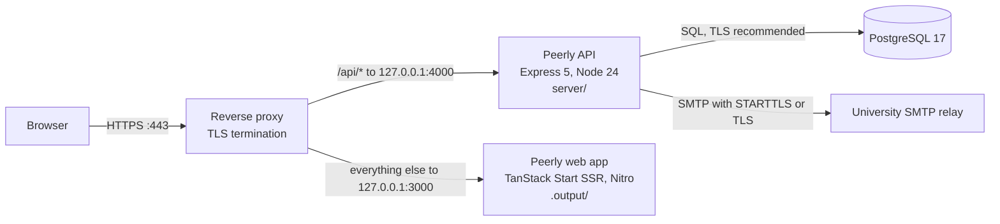

# Peerly technical handover guide

This guide covers requirements OR-26 and OR-27 (the deployment runbook). It is written for the university IT team who will run and maintain Peerly after handover. It assumes you are comfortable with Linux, Node.js, PostgreSQL and a reverse proxy, but have not seen this codebase before.

| Document | What it covers |
| --- | --- |
| [README.md](../../README.md#running-the-project) | Quick start for developers: commands and seeded sign-in accounts |
| **[deployment.md](./deployment.md)** | **Deploying to a server: the short path, start to finish, with every credential and value you must obtain collected up front. Start there if that is your job.** |
| This guide | Architecture, setup, tests, deployment, backup, maintenance, troubleshooting |
| [test-plan.md](./test-plan.md) | A scripted test pass over the whole system, written for testers |
| [test-walkthrough.md](./test-walkthrough.md) | The exhaustive version: every page and every function, once, in one sitting |
| [api.md](./api.md) | Every HTTP endpoint, with auth, request, response and errors |
| [erd.md](./erd.md) | Database diagram, data dictionary, and the constraints behind the business rules |
| [licences.md](./licences.md) | Third-party licence register |
| [ci.md](./ci.md) | The continuous-integration workflow |
| `user-guide-*.md` | End-user guides (administrator, lecturer, student) |
| [scope.md](../../scope.md) | Every requirement and its current status |

Items marked **TODO (deploying party)** are decisions that had not been made at handover. [Section 9](#9-not-yet-decided-todo-for-the-deploying-party) collects them all.

---

## Contents

1. [Architecture overview](#1-architecture-overview)
2. [Local setup from a clean machine](#2-local-setup-from-a-clean-machine)
3. [Configuration reference](#3-configuration-reference)
4. [Running the tests](#4-running-the-tests)
5. [Deployment runbook](#5-deployment-runbook)
6. [Backup and recovery](#6-backup-and-recovery)
7. [Maintenance](#7-maintenance)
8. [Troubleshooting](#8-troubleshooting)
9. [Not yet decided (TODO for the deploying party)](#9-not-yet-decided-todo-for-the-deploying-party)
10. [Known issues to be aware of](#10-known-issues-to-be-aware-of)

---

## 1. Architecture overview

Peerly is made of two Node.js processes and one PostgreSQL database, with a reverse proxy in front that terminates TLS.



| Component | Code | Technology | Responsibility |
| --- | --- | --- | --- |
| Web app | `src/` (repository root) | React 19, TanStack Start / Router, Tailwind v4, shadcn/ui. Built with Vite 8. Nitro produces a Node server bundle. | Renders the admin, lecturer and student portals. It holds **no** business rules and no secrets. All data comes from `/api` through `src/lib/api.ts` and `src/services/peerly.ts`. |
| API | `server/src/` | Express 5, TypeScript run directly by Node's type stripping, `pg`, `zod`, `bcryptjs`, `exceljs`, `nodemailer` | All business logic, authorisation, validation, calculation, export and e-mail |
| Database | `server/migrations/*.sql` | PostgreSQL 17 | The only persistent store. Business rules are enforced here as well, by constraints and triggers (see [erd.md](./erd.md#constraints-triggers-and-indexes-that-enforce-business-rules)). |

Useful facts about the API (`server/src/`):

| Path | What is there |
| --- | --- |
| `index.ts` | Starts the HTTP server. On SIGTERM or SIGINT it drains requests and exits within 10 seconds. |
| `app.ts` | Middleware order: helmet, CORS allow-list, JSON body (1 MB), cookie parser, global rate limit, then `/health`, the `/api/*` routers, and the error handler |
| `config/env.ts` | Reads and validates every environment variable with zod. **The process refuses to start on an invalid value.** |
| `routes/*.ts` | HTTP layer: auth, accounts, classes, assessments, student, audit. `uploads.ts` holds the multer settings. |
| `services/*.ts` | Business logic. Every function receives the calling user and checks ownership itself. |
| `middleware/auth.ts` | Session cookie handling, `requireAuth` and `requireRole` |
| `middleware/errors.ts` | The error envelope, and how database constraint errors become `409` |
| `lib/felder.ts` | The Felder calculation. It is a pure module with no database or HTTP (OR-18), and its configuration is `CalculationConfig`. |
| `lib/password.ts`, `lib/tokens.ts` | Password policy, bcrypt at cost 12, and random tokens stored only as SHA-256 hashes |
| `lib/mail.ts` | Sends e-mail through `log` (development) or `smtp`. Sending is fire-and-forget and never fails a request. |
| `db/pool.ts`, `db/migrate.ts`, `db/seed.ts` | Connection pool (max 10), migration runner, development seed data |

Design points that affect how you operate it:

- **Sessions are rows in the database, not JWTs.** The cookie holds a random token and the database holds its hash. Deactivating an account or changing its password revokes its sessions immediately. There is **no signing secret** to manage or rotate.
- **Uploaded class lists are never written to disk.** They are parsed in memory and then discarded. The database is the only state to back up.
- **E-mail is fire-and-forget.** A failure is logged (`[mail] could not send ...`) and the request still succeeds. Users can ask for a new code or link.
- **The audit log is append-only.** Triggers refuse `UPDATE` and `DELETE` on `audit_entries`.
- **Rate-limit counters live in process memory.** Run **one** API process. Two processes would each keep their own counts.

---

## 2. Local setup from a clean machine

These steps take a developer workstation (macOS or Linux) from nothing to both servers running against seeded data.

### 2.1 Prerequisites

| Tool | Version | Notes |
| --- | --- | --- |
| Node.js | **24 LTS** (tested with 24.21.0). The minimum is 22.12. | Vite 8 needs 22.12 or later. `npm start` in `server/` uses Node's built-in TypeScript type stripping, which needs 22.6 or later. The README's "22+" is the floor, and 24 is what development and CI use. |
| npm | the one bundled with Node | Use `npm ci`. See [licences.md → Version pinning](./licences.md#version-pinning-si-11). |
| PostgreSQL | **17** (tested with 17.11) | 13 or later is the technical minimum (`gen_random_uuid()` is built in). Develop and deploy on 17. |
| git | any | |
| Chromium for Playwright | installed by `npx playwright install chromium` | Only needed for the browser tests |

### 2.2 Steps

```sh
git clone <repository-url> peerly && cd peerly

# 1. Databases (development and unit tests)
createdb peerly_dev
createdb peerly_test

# 2. Web app
npm ci
cp .env.example .env            # optional: leave VITE_API_URL empty

# 3. API
cd server
npm ci
cp .env.example .env            # defaults work for local dev; check DATABASE_URL
npm run migrate                 # applies server/migrations/*.sql in order
npm run seed                    # demo data; refuses anything but *_dev / *_test
npm run dev                     # API on http://localhost:4000 (tsx watch)

# 4. In a second terminal, from the repository root
npm run dev                     # web app on http://127.0.0.1:7331
```

Open http://127.0.0.1:7331. The seeded accounts and their shared password are listed in [README.md → Signing in](../../README.md#signing-in). The role switcher in the corner signs in through the real API.

**Both servers must be running.** The Vite dev server proxies `/api` to `localhost:4000`, so the browser sees a single origin and sends the session cookie. Do not set `VITE_API_URL` to `http://localhost:4000`. That makes the API cross-site, and the browser silently drops the cookie.

With the default `MAIL_TRANSPORT=log`, e-mails (verification codes, activation and reset links) are **printed in the API terminal** instead of being sent.

### 2.3 Database commands (`server/package.json`)

| Command | What it does |
| --- | --- |
| `npm run migrate` | Applies pending migrations. Each file runs in its own transaction and its checksum is recorded. |
| `npm run migrate:status` | Lists each migration as `applied`, `PENDING` or `CHANGED SINCE APPLIED` |
| `npm run seed` | Rebuilds the deterministic demo data: 3 staff, 30 students, 2 classes, groups, and assessments. **It refuses to run in production or on a database whose name does not end in `_dev` or `_test`.** |
| `npm run reset` | Drops and recreates the `public` schema, migrates, then seeds. It has the same `_dev`/`_test`-only guard. |
| `npm run typecheck` | `tsc --noEmit` |

These scripts use `tsx`, which is a devDependency. On a production host installed with `npm ci --omit=dev`, run the runner through Node directly instead: `node --experimental-strip-types src/db/migrate.ts up` (or `status`). This was verified to work.

---

## 3. Configuration reference

### 3.1 API: `server/.env`

The API reads `server/.env` through `dotenv`, and real environment variables take precedence. Every variable is validated in `server/src/config/env.ts`. **A bad value stops the process at start-up with a message naming the variable.** `server/.env.example` is the template. `server/.env` is git-ignored and must never be committed (SR-13).

| Variable | Default | What it does | Production value |
| --- | --- | --- | --- |
| `NODE_ENV` | `development` | `production` enables the `Secure` cookie flag and the production rate-limit figures, forces `MAIL_TRANSPORT=smtp`, and blocks `seed` and `reset` | `production` |
| `PORT` | `4000` | API listen port | `4000`, bound behind the proxy |
| `DATABASE_URL` | none (**required**) | PostgreSQL connection string. Append `?sslmode=require` (or `verify-full` with `sslrootcert=...`) for a TLS database connection (SI-03). | **TODO (deploying party)** |
| `CORS_ORIGINS` | `http://127.0.0.1:7331,http://localhost:7331` | Comma-separated origins allowed to call the API. **Browsers send `Origin` even on same-origin writes, and a missing origin causes HTTP 500 on every POST.** | The public origin, for example `https://peerly.nwu.ac.za` |
| `APP_URL` | `http://127.0.0.1:7331` | Base URL used to build links in e-mails (`/activate?...`, `/reset-password?...`) | The public origin |
| `STUDENT_EMAIL_DOMAINS` | `mynwu.ac.za` | Comma-separated. Registration accepts only these domains. | Confirm with the Sponsor (IS-01) |
| `STAFF_EMAIL_DOMAINS` | `nwu.ac.za` | Comma-separated. Staff accounts must use these domains. | Confirm with the Sponsor (IS-01) |
| `SESSION_IDLE_MINUTES` | `30` | A session ends after this much inactivity (SR-05) | 30 |
| `SESSION_ABSOLUTE_MINUTES` | `720` | Maximum session length, regardless of activity. This is also the cookie's `Max-Age`. | 720 |
| `ACTIVATION_TOKEN_MINUTES` | `1440` | Lifetime of a staff activation link (FR-03) | 1440 |
| `RECOVERY_TOKEN_MINUTES` | `60` | Lifetime of a password-reset link (FR-06) | 60 |
| `EMAIL_CODE_MINUTES` | `10` | Lifetime of the 6-digit registration code | 10 |
| `MAIL_TRANSPORT` | `log` | `log` prints e-mails, **including tokens**, to stdout. `smtp` sends them. In production anything other than `smtp` is refused at start-up (SR-14). | `smtp` |
| `SMTP_HOST` | none | Required when `smtp` | **TODO (deploying party)** |
| `SMTP_PORT` | `587` | `587` with `SMTP_SECURE=false` (STARTTLS), or `465` with `SMTP_SECURE=true` | Per relay |
| `SMTP_SECURE` | `false` | `true` means implicit TLS | Per relay |
| `SMTP_USER`, `SMTP_PASSWORD` | none | Required when `smtp`. Authenticated SMTP only (CI-05). | **TODO (deploying party)** |
| `MAIL_FROM_NAME` | `Peerly` | Sender display name | `Peerly` |
| `MAIL_FROM_ADDRESS` | none | Required when `smtp`. It must be an address the relay is allowed to send as (SPF/DKIM). | **TODO (deploying party)** |
| `MAIL_REPLY_TO` | none | Optional reply-to address | Optional |
| `TEST_DATABASE_URL` | `postgres://localhost:5432/peerly_test` | Used only by the API test suite | Not used |
| `SEED_PASSWORD` | `peerly-dev-password` | The password every account created by `npm run seed` shares. The default is published in this repository, so any seeded database reachable over a network **must** set its own. Production never seeds, so this is unused there. | Not used |
| `DOTENV_CONFIG_QUIET` | none | Set to `true` to stop dotenv 17 printing its "injected env" line at start-up | `true` (optional) |

Settings that are **not** environment variables, and are changed in code or data:

- The global rate limit (300 requests per minute per IP) is in `app.ts`. The per-route limits (sign-in 20 per 15 minutes, e-mail 8 per hour) are in `routes/auth.ts`. The lock-out (5 failures for 15 minutes, 30 per IP) is in `services/authentication.ts`.
- `trust proxy` is `1` in `app.ts`. See [5.4](#54-tls-termination-and-the-reverse-proxy).
- The upload limit (5 MB, 2,000 rows) is in `services/class-list.ts`.
- The calculation configuration is in `lib/felder.ts`. See [7.6](#76-changing-the-felder-calculation-configuration).
- The rating scale is in the `rating_options` table. See [7.5](#75-changing-the-rating-scale).

### 3.2 Web app: `.env` (repository root)

| Variable | Default | What it does |
| --- | --- | --- |
| `VITE_API_URL` | empty | Prefix for API calls. **Leave it empty** in development and production, where `/api` is on the same origin. It is baked in at **build time**. Vite exposes `VITE_*` variables to the browser, so never put a secret here. |

At runtime the built web server (`.output/server/index.mjs`, Nitro's `node-server` preset) reads `PORT` (default 3000) and `HOST`, or `NITRO_PORT` and `NITRO_HOST`.

---

## 4. Running the tests

| Suite | Where | Command | Needs |
| --- | --- | --- | --- |
| API unit and integration (vitest 4) | `server/` | `npm test` | PostgreSQL with a `peerly_test` database |
| Felder coverage | `server/` | `npm run coverage` | Same. Prints branch coverage of `lib/felder.ts`, which must stay at 90% or more (OR-20). |
| API typecheck | `server/` | `npm run typecheck` | |
| Web unit (vitest 3) | root | `npm test` | Nothing |
| Web lint and types | root | `npm run lint` and `npx tsc --noEmit` | |
| Browser end-to-end (Playwright) | root | `npx playwright test` | Both dev servers running, `peerly_dev` present, Chromium installed |

**API tests.** `server/vitest.config.ts` forces `NODE_ENV=test` and points `DATABASE_URL` at `TEST_DATABASE_URL`, which defaults to `postgres://localhost:5432/peerly_test`. A stray `.env` therefore cannot aim the tests at your development data. The global setup (`src/test/global-setup.ts`) runs the real migration runner against the test database first. Test files truncate tables between cases, so they run one at a time (`fileParallelism: false`). bcrypt drops to cost 4 under test to keep the suite fast.

**Web unit tests** (`src/**/*.test.ts`) cover the framework-free logic in `src/lib/`.

**Playwright** (`playwright.config.ts`, `e2e/`):

- Start both servers first (`npm run dev` in `server/` and at the root). When `CI` is set, the config starts them itself. See [ci.md](./ci.md).
- `e2e/global-setup.ts` runs `npm run seed` in `server/`, which **wipes and reseeds `peerly_dev`** before every run. Don't run it against a development database you care about.
- It runs with one worker, serially. The projects are `setup` (signs in and saves the cookies to `e2e/.auth/`), `lecturer`, `student`, `admin` and `anonymous`. The base URL is `http://127.0.0.1:7331`.
- First-time setup: `npx playwright install chromium`.
- `e2e/accessibility.spec.ts` uses axe-core.

The CI workflow that runs all of these on each push and pull request is described in [ci.md](./ci.md).

---

## 5. Deployment runbook

> Deploying for the first time? [`deployment.md`](./deployment.md) is this
> section in sequential order, with a worksheet of every credential and value
> you have to obtain before you start. This section remains the reference; that
> one is the path through it.

### 5.1 Target topology

On one Linux host (HI-03: at least 2 vCPU, 4 GB RAM and 20 GB disk), or with PostgreSQL on a separate managed host:

| Process | Listens on | Started by |
| --- | --- | --- |
| Reverse proxy (nginx, Apache or the university proxy) | `:443` public, and `:80` for the redirect only | OS service |
| Peerly web app | `127.0.0.1:3000` | systemd `peerly-web.service` |
| Peerly API | `127.0.0.1:4000` | systemd `peerly-api.service` |
| PostgreSQL 17 | `127.0.0.1:5432` or a managed host | OS service or managed |

Only port 443 is exposed (CI-09). Both Node processes bind to loopback.

### 5.2 Before you start

- [ ] Server host and DNS name for Peerly. **TODO (deploying party)**, see IS-10.
- [ ] TLS certificate for that name. **TODO (deploying party)**
- [ ] PostgreSQL 17 instance, and credentials for a database called `peerly`. **TODO (deploying party)**
- [ ] SMTP relay host, port, username, password and an approved sender address. **TODO (deploying party)**
- [ ] Backup destination, encryption key custodian and retention. **TODO (deploying party)**, see [6](#6-backup-and-recovery).
- [ ] The confirmed e-mail domain list (IS-01).
- [ ] The name and institutional e-mail address of the first System Administrator (AS-06).

### 5.3 Install

Run these steps as a dedicated unprivileged user, for example `peerly`, in `/opt/peerly`:

```sh
# Node 24 LTS from your usual source (distribution package, NodeSource, or nvm)
node -v    # v24.x

git clone <repository-url> /opt/peerly && cd /opt/peerly
git checkout <release-tag>

# --- Web app: the build needs devDependencies (vite, nitro) ---
npm ci
npm run build                      # writes .output/, which is self-contained
# The build can be done elsewhere, with only .output/ copied here. At runtime
# it needs nothing but Node.

# --- API ---
cd server
npm ci --omit=dev                  # runtime dependencies only
cp .env.example .env && chmod 600 .env
$EDITOR .env                       # see 3.1. NODE_ENV=production, MAIL_TRANSPORT=smtp, ...
```

### 5.4 TLS termination and the reverse proxy

Configure the proxy to:

1. **Terminate TLS**, allowing TLS 1.2 and 1.3 only, and **redirect HTTP to HTTPS** (CI-01).
2. Send **`/api/`** to `http://127.0.0.1:4000` and **everything else** to `http://127.0.0.1:3000`. This keeps the browser on one origin, which the `SameSite=Lax` session cookie depends on.
3. Set `X-Forwarded-For` to the real client address. The API trusts **exactly one** proxy hop (`app.set("trust proxy", 1)`). If another load balancer or proxy sits in front of this one, Express sees that device's address as the client, so every user shares one rate-limit bucket. Worse, 30 failed sign-ins from anyone would lock out sign-in for everybody for 15 minutes. In that case, change the value in `server/src/app.ts` to the number of hops, or to the proxy's address range.
4. Allow request bodies of at least 6 MB (class-list uploads are limited to 5 MB).
5. Send `Strict-Transport-Security` on every response. The API already sends it through helmet. The web app does not.

Here is an example nginx configuration. Adapt it to the university's standard.

```nginx
server {
    listen 80;
    server_name peerly.example.ac.za;           # TODO (deploying party)
    return 301 https://$host$request_uri;
}

server {
    listen 443 ssl;
    http2 on;
    server_name peerly.example.ac.za;           # TODO (deploying party)

    ssl_certificate     /etc/ssl/peerly/fullchain.pem;   # TODO
    ssl_certificate_key /etc/ssl/peerly/privkey.pem;     # TODO
    ssl_protocols TLSv1.2 TLSv1.3;
    add_header Strict-Transport-Security "max-age=31536000; includeSubDomains" always;

    client_max_body_size 6m;

    proxy_set_header Host              $host;
    proxy_set_header X-Forwarded-For   $proxy_add_x_forwarded_for;
    proxy_set_header X-Forwarded-Proto $scheme;

    location /api/ { proxy_pass http://127.0.0.1:4000; }
    location /     { proxy_pass http://127.0.0.1:3000; }
    # Optional, for monitoring from inside the network only:
    # location = /health { allow 10.0.0.0/8; deny all; proxy_pass http://127.0.0.1:4000; }
}
```

With `NODE_ENV=production`, the session cookie is `Secure`. It is only stored over HTTPS, so the site must be reached over HTTPS.

### 5.5 Database

```sql
-- As a PostgreSQL administrator:
CREATE ROLE peerly LOGIN PASSWORD '<generated>';      -- TODO: store in the university vault
CREATE DATABASE peerly OWNER peerly;
```

Then in `server/.env`, set `DATABASE_URL=postgres://peerly:<password>@<host>:5432/peerly?sslmode=require`. Use `sslmode=require` or `verify-full` whenever the database is not on the same host (SI-03).

#### Database roles

- The `peerly` role owns the schema, because the migration runner creates tables, types and triggers. It must **not** be a superuser. A superuser can disable the audit triggers or `TRUNCATE audit_entries`, and the append-only guarantee (FR-27) only holds against non-superusers.
- Optional hardening: create a second role, `peerly_app`, with only `SELECT, INSERT, UPDATE, DELETE` on the tables and `USAGE` on the sequences. Point the running API at `peerly_app`, and run migrations with the owner role. The code doesn't need changing for this. It needs two connection strings and a `GRANT` after each migration.

### 5.6 Migrations on deploy

Run migrations **before** starting a new API version, after taking a backup:

```sh
cd /opt/peerly/server
./backup-now.sh                          # or the pg_dump command in 6.2
node --experimental-strip-types src/db/migrate.ts status
node --experimental-strip-types src/db/migrate.ts up
```

- Each migration runs in its own transaction. A failed migration rolls back and stops the run, and anything that had already succeeded stays applied.
- If `status` shows `CHANGED SINCE APPLIED`, someone edited a migration that had already run. The runner refuses to continue. Put the file back to its original content and add a new migration instead.
- Never run `npm run seed` or `npm run reset` in production. Both refuse, but don't rely on the guard.
- The migrations seed the rating scale (`0002`). No other reference data is needed.

### 5.7 Run as services

`/etc/systemd/system/peerly-api.service`:

```ini
[Unit]
Description=Peerly API
After=network.target postgresql.service

[Service]
User=peerly
WorkingDirectory=/opt/peerly/server
Environment=NODE_ENV=production
Environment=DOTENV_CONFIG_QUIET=true
ExecStart=/usr/bin/node --experimental-strip-types src/index.ts
Restart=on-failure
# index.ts drains in-flight requests on SIGTERM (at most 10 seconds)
TimeoutStopSec=15

[Install]
WantedBy=multi-user.target
```

`/etc/systemd/system/peerly-web.service`:

```ini
[Unit]
Description=Peerly web app
After=network.target

[Service]
User=peerly
WorkingDirectory=/opt/peerly
Environment=NODE_ENV=production
Environment=HOST=127.0.0.1
Environment=PORT=3000
ExecStart=/usr/bin/node .output/server/index.mjs
Restart=on-failure

[Install]
WantedBy=multi-user.target
```

```sh
sudo systemctl daemon-reload
sudo systemctl enable --now peerly-api peerly-web
journalctl -u peerly-api -f       # expect "Peerly API listening on http://localhost:4000 (production)"
```

`npm start` in `server/` runs the same command as the `ExecStart` line above.

### 5.8 SMTP

- Set `MAIL_TRANSPORT=smtp` and fill in `SMTP_HOST`, `SMTP_PORT`, `SMTP_SECURE`, `SMTP_USER`, `SMTP_PASSWORD` and `MAIL_FROM_ADDRESS`. The API will not start in production without them.
- Ask the mail team to authorise `MAIL_FROM_ADDRESS` (SPF and DKIM). Otherwise institutional mail filters may quarantine verification codes. **Test delivery to both `@mynwu.ac.za` and `@nwu.ac.za` addresses before go-live** (AS-07, AS-09).
- E-mail is sent in the background. Delivery failures appear in the API log as `[mail] could not send "<subject>" to <address>: <reason>`. The message body is never logged, because it contains the token.

### 5.9 The initial administrator account (AS-06)

Peerly has **no default administrator and no built-in password.** The seed script is for development only and refuses to run in production. The first administrator is created once, at deployment, with the procedure below. The procedure was tested end to end against a freshly migrated database on 2026-09-22.

The procedure creates an `unverified` admin account with no password, plus a one-time activation token. The person opens the link and chooses their own password, and the password policy (SR-02) applies. From then on, that administrator creates every other staff account in the Admin Portal.

Run it on the API host from `/opt/peerly/server`, with `DATABASE_URL` exported:

```sh
ADMIN_EMAIL='firstname.surname@nwu.ac.za'     # TODO: the university's first System Administrator
ADMIN_NAME='Firstname'
ADMIN_SURNAME='Surname'
PUBLIC_URL='https://peerly.example.ac.za'      # TODO: same as APP_URL

TOKEN=$(node -e 'console.log(require("node:crypto").randomBytes(32).toString("base64url"))')
TOKEN_HASH=$(node -e 'console.log(require("node:crypto").createHash("sha256").update(process.argv[1]).digest("hex"))' "$TOKEN")

psql -X -v ON_ERROR_STOP=1 "$DATABASE_URL" \
  -v email="$ADMIN_EMAIL" -v name="$ADMIN_NAME" -v surname="$ADMIN_SURNAME" -v token_hash="$TOKEN_HASH" <<'SQL'
BEGIN;
WITH admin AS (
  INSERT INTO users (role, name, surname, email, status)
  VALUES ('admin', :'name', :'surname', :'email', 'unverified')
  RETURNING id, name, surname, email
), token AS (
  INSERT INTO auth_tokens (user_id, purpose, token_hash, expires_at)
  SELECT id, 'activation', :'token_hash', now() + interval '24 hours' FROM admin
)
INSERT INTO audit_entries (actor_name, event_type, object_description, detail)
SELECT 'System', 'account.created', name || ' ' || surname || ' · ' || email,
       'Initial administrator created at deployment (AS-06); activation link issued out of band.'
  FROM admin;
COMMIT;
SQL

echo "$PUBLIC_URL/activate?token=$TOKEN&email=$ADMIN_EMAIL"
unset TOKEN TOKEN_HASH
```

Deliver the printed link to the administrator over a trusted channel. It works once and expires in 24 hours. When they open it, they set a password and are signed in. The audit log then shows `account.created` by `System`, followed by `account.activated`.

**If the deploying party holds this first account themselves, rotate it at handover (AS-06, SR-13):**

1. The deploying party's administrator creates the university's own administrator(s) in **Admin Portal → Accounts** (`POST /api/accounts`). Those people activate their accounts from the e-mailed links.
2. A university administrator **deactivates** the deploying party's account. The system refuses to deactivate the last active administrator, so this has to happen after step 1.
3. Record the change of ownership in the handover sign-off.

If the first account is created directly for a named university administrator, nobody but that person ever knows the password, and nothing needs rotating.

### 5.10 Post-deployment checks

```sh
curl -s https://peerly.example.ac.za/api/auth/me          # {"error":{"code":"unauthorized",...}}  (proves /api routing)
curl -s http://127.0.0.1:4000/health                      # {"status":"ok","database":"up"}
node --experimental-strip-types src/db/migrate.ts status  # every migration "applied"
```

Then, in a browser:

1. Open the public URL. Confirm HTTPS, the redirect from `http://`, and that the certificate is valid.
2. Activate the first administrator (5.9) and sign in.
3. Create a test lecturer account. Confirm the activation e-mail **arrives** (this tests SMTP), then deactivate the account.
4. Use **Forgot password** for the administrator's address. Confirm the reset e-mail arrives and its link points to the public URL (this tests `APP_URL`).
5. Register a test student with an institutional address. Confirm the 6-digit code arrives.
6. Take the first backup and do a restore test (6.4).

### 5.11 Upgrading to a new release

```sh
cd /opt/peerly
git fetch && git checkout <new-tag>
npm ci && npm run build                          # web app
(cd server && npm ci --omit=dev)
./server/backup-now.sh                           # back up first
(cd server && node --experimental-strip-types src/db/migrate.ts up)
sudo systemctl restart peerly-api peerly-web
```

**Rollback.** Check out the previous tag, rebuild and restart. If the new release included a migration, the old code may not work with the new schema. Migrations are not reversible, so in that case restore the pre-upgrade backup (6.3), which loses any data entered since. Plan upgrades for times outside active assessment windows.

---

## 6. Backup and recovery

### 6.1 What to back up

| Item | How | Why |
| --- | --- | --- |
| The `peerly` PostgreSQL database | `pg_dump` (below), or the managed service's snapshots and point-in-time recovery | This is **all** of Peerly's data. Uploads are never stored and there are no local files. |
| `server/.env` | In the university's secrets vault, **not** in the database backup | It holds the database and SMTP credentials |
| Deployed release tag | Recorded in the change log | So you can rebuild exactly the same code |

The OR-10 and SR-12 target is **daily encrypted backups, kept for 30 days, with restoration tested before handover**.

### 6.2 Backup procedure

Save the following as `/opt/peerly/server/backup-now.sh`, mode 700 and owned by `peerly`:

```sh
#!/usr/bin/env sh
set -eu
# Loads DATABASE_URL (and nothing else is needed) from the API's env file.
. /opt/peerly/server/.env
DEST=/var/backups/peerly                       # TODO (deploying party): backup destination
STAMP=$(date -u +%Y%m%dT%H%M%SZ)
mkdir -p "$DEST"

# Custom format: compressed, and restorable table by table with pg_restore.
pg_dump --format=custom --no-owner --dbname="$DATABASE_URL" --file="$DEST/peerly-$STAMP.dump"

# Encrypt at rest. age or gpg both work. Keep the private key OFF this host.
age -r "$(cat /etc/peerly/backup-recipient.pub)" -o "$DEST/peerly-$STAMP.dump.age" "$DEST/peerly-$STAMP.dump"   # TODO: key custodian
rm "$DEST/peerly-$STAMP.dump"

# Keep 30 days.
find "$DEST" -name 'peerly-*.dump.age' -mtime +30 -delete

# Copy off-host.   TODO (deploying party): rsync, object storage or the university backup system
```

`. .env` works because `server/.env` holds plain `KEY=value` lines with no spaces. If you add a value containing spaces, quote it.

Schedule the script **daily**, for example at 02:00 SAST, with cron (`0 2 * * * /opt/peerly/server/backup-now.sh`) or a systemd timer. Alert on a non-zero exit. Also run it by hand before every upgrade or migration.

On a managed PostgreSQL service, you can use the provider's automated snapshots and point-in-time recovery instead. Set them to at least 30 days of retention with encryption turned on. Still take a `pg_dump` before each upgrade.

`pg_dump` runs as a normal transaction, so the API can stay up. The database is small: the development database with 30 students, 179 audit entries and 186 ratings dumps to about 90 KB.

### 6.3 Restore procedure

```sh
# 1. Stop the API so nothing writes during the restore.
sudo systemctl stop peerly-api

# 2. Decrypt the chosen backup.
age -d -i /secure/backup-key.txt -o /tmp/peerly.dump /var/backups/peerly/peerly-<STAMP>.dump.age

# 3. Restore into a fresh database, then swap it in (safer than restoring on top).
createdb -O peerly peerly_restore
pg_restore --no-owner --role=peerly --exit-on-error --dbname=peerly_restore /tmp/peerly.dump

# 4. Verify (6.4), then swap:
psql -c "ALTER DATABASE peerly RENAME TO peerly_before_restore;"
psql -c "ALTER DATABASE peerly_restore RENAME TO peerly;"

# 5. Start the API and check it.
sudo systemctl start peerly-api
curl -s http://127.0.0.1:4000/health

# 6. Remove the plaintext dump. Keep peerly_before_restore until you are sure.
shred -u /tmp/peerly.dump
```

The dump contains the `schema_migrations` table, so the restored database knows which migrations it has. If the restored backup is older than the running code, run `migrate up` afterwards. Restoring brings back **sessions** from the time of the backup. To force everyone to sign in again, run `UPDATE sessions SET revoked_at = now() WHERE revoked_at IS NULL;`.

### 6.4 Restore test (before handover, then quarterly)

Run this into a scratch database. The live system is not touched.

```sh
createdb peerly_restore_test
pg_restore --no-owner --exit-on-error --dbname=peerly_restore_test /tmp/peerly.dump
DATABASE_URL=postgres://.../peerly_restore_test node --experimental-strip-types src/db/migrate.ts status   # all "applied"
psql -d peerly_restore_test -c "SELECT (SELECT count(*) FROM users) AS users,
                                        (SELECT count(*) FROM classes) AS classes,
                                        (SELECT count(*) FROM peer_ratings) AS ratings,
                                        (SELECT max(occurred_at) FROM audit_entries) AS latest_audit;"
psql -d peerly_restore_test -c "SELECT tgname FROM pg_trigger WHERE tgrelid = 'audit_entries'::regclass AND NOT tgisinternal;"
# expect audit_entries_no_delete and audit_entries_no_update
dropdb peerly_restore_test
```

Compare the counts and the latest audit timestamp with the live database at the time of the backup. Record the date, backup file, result and who ran the test.

This procedure (`pg_dump -Fc`, then `pg_restore` into a new database, then `migrate status` and the trigger check) was run against the development database on 2026-09-22: every migration showed as applied, the row counts matched, and both audit triggers were present. **The test on the production host and backup destination is still to be done, and it is required before handover (OR-10).**

---

## 7. Maintenance

### 7.1 Rotating secrets (SR-13)

| Secret | Where it lives | How to rotate |
| --- | --- | --- |
| Database password | `DATABASE_URL` in `server/.env` | `ALTER ROLE peerly PASSWORD '<new>';`, then update `.env` and `systemctl restart peerly-api`. Expect a few seconds of errors between the two steps, or create the new password first if your PostgreSQL setup supports two credentials. |
| SMTP password | `SMTP_PASSWORD` in `server/.env` | Change it with the mail team, update `.env`, restart the API |
| TLS certificate | reverse proxy | Your usual renewal process. Peerly is not involved. |
| Backup encryption key | backup host / vault | Generate a new key pair and switch the script to the new recipient. **Keep the old private key** for as long as backups encrypted with it are retained (30 days). |
| Session tokens | `sessions` table | There is no signing key. To sign everyone out, for example after a suspected compromise: `UPDATE sessions SET revoked_at = now() WHERE revoked_at IS NULL;` |
| Initial administrator credential | the person's own password | See [5.9](#59-the-initial-administrator-account-as-06). The holder can also change it themselves under **Settings → Change password**. |

At handover, rotate the database and SMTP passwords if the deploying party ever saw them (SR-13).

### 7.2 Adding a lecturer or administrator

1. A System Administrator signs in and opens **Admin Portal → Accounts → Add account**.
2. Enter the role, name, surname and **institutional e-mail address** (it must be in `STAFF_EMAIL_DOMAINS`).
3. Peerly e-mails an activation link, valid for `ACTIVATION_TOKEN_MINUTES` (24 hours by default). The new user opens it and sets their own password. Nobody else ever knows it.
4. To remove access, **deactivate** the account. This signs the user out everywhere and deletes nothing (BR-14). No route deletes accounts.

The step-by-step screens are in the administrator user guide.

#### Re-sending an expired staff activation link

The API has no "resend activation" endpoint yet. If a new staff member's link expires, issue a new token for the existing account in the same way as 5.9:

```sh
TOKEN=$(node -e 'console.log(require("node:crypto").randomBytes(32).toString("base64url"))')
TOKEN_HASH=$(node -e 'console.log(require("node:crypto").createHash("sha256").update(process.argv[1]).digest("hex"))' "$TOKEN")
psql -X -v ON_ERROR_STOP=1 "$DATABASE_URL" -v email="$STAFF_EMAIL" -v token_hash="$TOKEN_HASH" <<'SQL'
BEGIN;
UPDATE auth_tokens SET consumed_at = now()
 WHERE purpose = 'activation' AND consumed_at IS NULL
   AND user_id = (SELECT id FROM users WHERE lower(email) = lower(:'email') AND status = 'unverified');
INSERT INTO auth_tokens (user_id, purpose, token_hash, expires_at)
SELECT id, 'activation', :'token_hash', now() + interval '24 hours'
  FROM users WHERE lower(email) = lower(:'email') AND status = 'unverified';
COMMIT;
SQL
echo "$PUBLIC_URL/activate?token=$TOKEN&email=$STAFF_EMAIL"
```

If `INSERT 0 0` is printed, the account is not `unverified`. It is either already active, in which case the user should use **Forgot password**, or it was typed wrongly.

### 7.3 Students

Students register themselves with their institutional address and student number, and verify with a 6-digit code. Nobody creates student accounts, and the Admin Portal does not list students (SR-16). A student who cannot sign in should use **Forgot password**, or wait 15 minutes if they have locked the account with five wrong passwords.

### 7.4 Changing accepted e-mail domains

Edit `STUDENT_EMAIL_DOMAINS` or `STAFF_EMAIL_DOMAINS` (comma-separated) and restart the API. Existing accounts are not affected.

### 7.5 Changing the rating scale

The scale is data in the `rating_options` table, seeded by migration `0002` (see [erd.md](./erd.md#rating_options)). No admin screen edits it. Change it **with a new migration** so that every environment stays reproducible (OR-21):

```sql
-- server/migrations/0004_rating_scale_2027.sql  (example)
UPDATE rating_options SET active = false WHERE label = 'Superficial';
INSERT INTO rating_options (label, description, hidden_value, display_order)
VALUES ('Minimal', 'Contributed very little ...', 10, 10);
```

Read these rules before you do it:

- **Never delete an option that has been used.** `peer_ratings.rating_option_id` references it without a cascade, so the delete fails. Set `active = false` instead. Inactive options disappear from the rating form, and past ratings still resolve.
- **Think carefully before changing a used option's `hidden_value`.** `calculation_runs.config` freezes the *calculation* settings, and `calculated_results` freezes each run's *numbers*. The option values themselves are **not** frozen. If an older assessment is recalculated after the change, it uses the new values. Existing stored results do not change until someone recalculates. Safer: deactivate the old option and add a new one.
- `label` and `display_order` are unique. Renumber carefully, in a single migration.
- The advisory thresholds in the calculation config (`lowContributionThreshold: 79`, `outlierThreshold: 10`) are set for the banded scale, whose options sit about five apart. If you change the scale, change them as well (7.6), and the matrix highlight step in `src/lib/domain.ts` (`deviationFrom`, currently 5).
- The scale is global. It applies to every class and assessment.

### 7.6 Changing the Felder calculation configuration

Every configurable part of the calculation is in **`CalculationConfig`**, and its values are in **`DEFAULT_CONFIG`** in `server/src/lib/felder.ts`:

| Field | Current value | Meaning |
| --- | --- | --- |
| `ruleVersion` | `felder-2026.3-provisional` | Name of this rule set. It is stored with every run. |
| `minFactor`, `maxFactor` | `0.6`, `1.1` | Limits the adjustment factor is clamped to (FR-22 step 4, BR-07) |
| `roundTo` | `1` | Decimal places for the final mark. This is the **only** rounding step. Agreed 2026-09-23: it matches the precision the mark is recorded at, so the mark is rounded once rather than rounded here and rounded again downstream. |
| `neutralFactor` | `1` | Factor used when there is nothing to calculate from, such as a group of one or a student nobody rated |
| `lowContributionThreshold` | `79` (*Marginal*) | Mean received rating at or below this value is flagged as low contribution (advisory only) |
| `outlierThreshold` | `10` (two steps) | Distance from the group mean at which a single rating is flagged as an outlier (advisory only) |

The rating scale (migration 0004), the factor limits and the exclusion of self-ratings were agreed on 2026-09-22, and the rounding rule on 2026-09-23. The neutral factor and the two flag thresholds are still **provisional** until the Sponsor approves the Felder Calculation Specification (AS-08, IS-02, IS-04). Each run stores its config **and the rating scale** in `calculation_runs.config`.

To change them:

1. Edit `DEFAULT_CONFIG` and **change `ruleVersion`**, for example to `felder-2027-v1`, so that runs under the new rules can be told apart.
2. Update or add cases in `server/src/lib/felder.test.ts`, then run `npm test` and `npm run coverage` (branch coverage must stay at 90% or more, OR-20).
3. Deploy as a normal release (5.11). No migration is needed.

**What happens to existing marks.** Every calculation stores a `calculation_runs` row whose `config` column is the complete `CalculationConfig` used for that run, frozen as JSON. `calculated_results` stores that run's figures, including the unclamped `raw_factor`. Existing results **do not change** when the config changes. A mark calculated last semester can still be explained from its own run. An assessment only picks up the new rules if a lecturer presses **Calculate** again. That creates a new run. The old run row stays, and its results are replaced. To see which rules produced what:

```sql
SELECT a.name, r.created_at, r.rule_version, r.config
  FROM calculation_runs r JOIN assessments a ON a.id = r.assessment_id
 ORDER BY r.created_at DESC;
```

### 7.7 Changing the database schema

Add a new file, `server/migrations/NNNN_description.sql`, using the next number. The runner applies files in filename order. **Never edit a migration that has already been applied anywhere.** The checksum check stops the runner if you do. Test the migration on a restored copy of production (6.4) before deploying it. Update [erd.md](./erd.md) in the same change.

### 7.8 Housekeeping

Nothing below affects correctness, since expired rows are already ignored, but some tables grow without limit. Schedule this monthly (it is safe while the system is running):

```sql
-- Sessions that ended more than 7 days ago (same rule as purgeExpiredSessions() in services/sessions.ts, which nothing calls yet)
DELETE FROM sessions WHERE expires_at < now() - interval '7 days'
   OR (revoked_at IS NOT NULL AND revoked_at < now() - interval '7 days');
-- Spent or expired tokens and codes
DELETE FROM auth_tokens WHERE consumed_at IS NOT NULL OR expires_at < now() - interval '7 days';
DELETE FROM email_verification_codes WHERE consumed_at IS NOT NULL OR expires_at < now() - interval '7 days';
-- Sign-in attempts. The lock-out only looks back 15 minutes, so 90 days is plenty.
DELETE FROM login_attempts WHERE attempted_at < now() - interval '90 days';
```

**Never** try to prune `audit_entries`. The triggers refuse it. A retention period for class and assessment data (IS-07, POPIA) is still to be decided. When it is, removing old classes is done in the lecturer portal (FR-28).

### 7.9 Logs and monitoring

- Both processes log to stdout and stderr. Under systemd, use `journalctl -u peerly-api` and `journalctl -u peerly-web`.
- The API does **not** log each request. Use the reverse proxy's access log for traffic.
- API log prefixes: `[error]` is an unexpected 500, logged with its stack trace. `[db] rule violation <code> on <constraint>` is a write refused by a constraint, returned to the client as a 409. `[db] idle client error` means a pooled connection dropped and was recovered. `[mail] could not send ...` is an e-mail delivery failure. Passwords, tokens and rating content are never logged (SR-14).
- Monitor `GET /health`, which returns 503 when the database is unreachable. Also monitor certificate expiry and disk space, and alert on failures of the backup job.

### 7.10 Updating dependencies

Run `npm outdated` in both packages, update one area at a time, and install with `npm ci` from the updated lockfile. Run the full test set (section 4), then update [licences.md](./licences.md), including a new scan. `nitro` is pinned to a beta (`3.0.260603-beta`) and the TanStack packages are pinned exactly. Upgrade them together and test the build carefully.

---

## 8. Troubleshooting

| Symptom | Likely cause | Fix |
| --- | --- | --- |
| API exits at start with `Invalid server configuration:` followed by a list | A missing or invalid environment variable. The list names each one. | Fix `server/.env`. In production, `MAIL_TRANSPORT=smtp` and all `SMTP_*` values plus `MAIL_FROM_ADDRESS` are required. |
| **Every** save, sign-in or other POST fails with "Something went wrong on our end", while GET pages load | The public origin is missing from `CORS_ORIGINS`. The API answers 500 for origins not on the list. | Add `https://<public host>` to `CORS_ORIGINS` and restart the API |
| Sign-in "succeeds" but the next page says "Please sign in" | The cookie is not being stored or sent. The site is being reached over plain HTTP in production (`Secure` cookie), or the web app and API are on different sites (`VITE_API_URL` set, or `/api` not proxied). | Serve over HTTPS on one origin. Leave `VITE_API_URL` empty and proxy `/api/`. |
| Everyone gets "We couldn't sign you in" or `429` at once | Rate limits and lock-outs are keyed on a single IP because there is an extra proxy hop | Fix `X-Forwarded-For` and the `trust proxy` setting (5.4) |
| One user can't sign in with the correct password | Account locked by 5 consecutive failures (15 minutes), not yet verified, or deactivated. The message is the same in every case, on purpose. | Wait 15 minutes. Check with `SELECT status FROM users WHERE lower(email)=lower('<email>');` and `SELECT * FROM login_attempts WHERE email=lower('<email>') ORDER BY attempted_at DESC LIMIT 10;` |
| Activation, reset or verification e-mails don't arrive | SMTP misconfigured, or the relay or spam filter is rejecting the sender | Look for `[mail] could not send` in `journalctl -u peerly-api`. Check SPF/DKIM for `MAIL_FROM_ADDRESS`. Users can request a new code or link. |
| E-mail links point to `127.0.0.1:7331` | `APP_URL` has not been set | Set `APP_URL` to the public URL and restart |
| `Migration failed: ... has already been applied but its contents have changed` | Someone edited an applied migration | Revert that file, `git checkout <file>`, and put the change in a new migration |
| `/health` returns `503 {"database":"down"}` | PostgreSQL is unreachable, credentials are wrong, or TLS settings are wrong | `psql "$DATABASE_URL" -c 'select 1'` from the API host |
| Class-list upload: "larger than 5 MB" or `413` from the proxy | The file really is too big, or the proxy body limit is below 6 MB | Split the file, or raise `client_max_body_size` |
| Upload of a damaged `.xlsx` shows the generic error | exceljs cannot open the file, which the API reports as a 500 | Re-save the file as `.xlsx` or `.csv` |
| "That change isn't allowed because it would break one of Peerly's rules." (409 `rule_violation`) | A database constraint refused the write | The log line `[db] rule violation <code> on <constraint>` names the constraint. Look it up in [erd.md](./erd.md). |
| Lecturer can't regroup a class | An assessment that is open or closed already has submissions (FR-11) | This is the intended behaviour. Create new groups in a new class, or use the existing groups. |
| Students see "hasn't opened yet" after the opening time | Status changes only when the lecturer acts. `opens_at` and `closes_at` do not open or close anything automatically. | The lecturer opens the assessment in the portal |
| `e2e` run wiped the development data | Playwright's global setup reseeds `peerly_dev` | Expected. Run `npm run seed` again if needed. |
| Web app port already in use (dev) | `vite.config.ts` pins port 7331 with `strictPort` | Stop whatever else is using port 7331 |

---

## 9. Not yet decided (TODO for the deploying party)

| Item | Needed for | Owner |
| --- | --- | --- |
| Production server host, DNS name and public URL (`APP_URL`, `CORS_ORIGINS`) | 5.1–5.4 | Deploying party / university IT (IS-10) |
| TLS certificate and reverse-proxy platform (nginx, Apache or the university proxy) | 5.4, CI-01, CI-09 | Deploying party / university IT |
| PostgreSQL instance (local or managed), `DATABASE_URL`, and whether TLS is used on the database connection | 5.5, SI-03 | Deploying party |
| SMTP relay: host, port, TLS mode, username and password, approved `MAIL_FROM_ADDRESS`, and SPF/DKIM | 5.8, CI-05 | University mail team |
| Backup destination (off-host), encryption tool and key custodian, and monitoring of the backup job | 6.2, OR-10, SR-12 | Deploying party / university IT |
| First production restore test, with its record | 6.4, OR-10 | Deploying party, **before handover** |
| Name and address of the first System Administrator, and the handover rotation (5.9) | AS-06 | Sponsor / university IT |
| Final student and staff e-mail domain lists | IS-01 | Sponsor |
| Felder Calculation Specification approval, and the resulting `DEFAULT_CONFIG` values | AS-08, OR-27 | Sponsor |
| Data retention period | IS-07, POPIA | Client |
| Image provenance and Peerly source licence/ownership | [licences.md](./licences.md#conclusion) | Sponsor / project owner |

---

## 10. Known issues to be aware of

The full list, with details, is in [api.md → Known issues](./api.md#known-issues). The ones that matter for operations are:

- An `Origin` missing from `CORS_ORIGINS` is refused with `403` and the message *"Origin … is not allowed to call this API."* If every write fails with that after a deploy, add the public URL to `CORS_ORIGINS`.
- There is no "resend activation link" endpoint for staff. Use the workaround in 7.2.
- `GET /api/assessments/:id/export` records an export as a side effect.
- An open assessment can be calculated, so BR-06 is only partly enforced.
- `purgeExpiredSessions()` exists but nothing schedules it. Use the SQL in 7.8.
