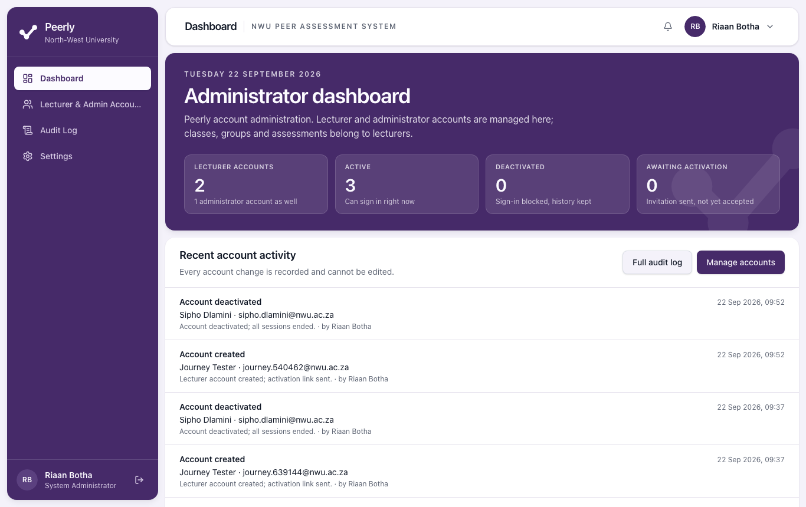
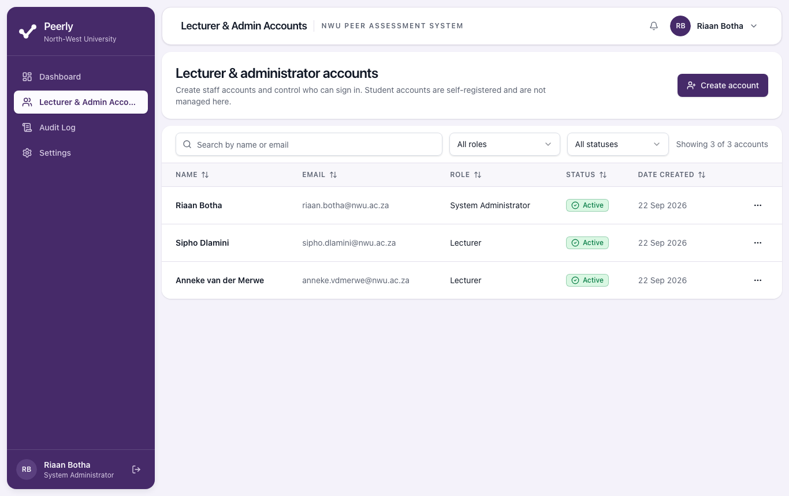
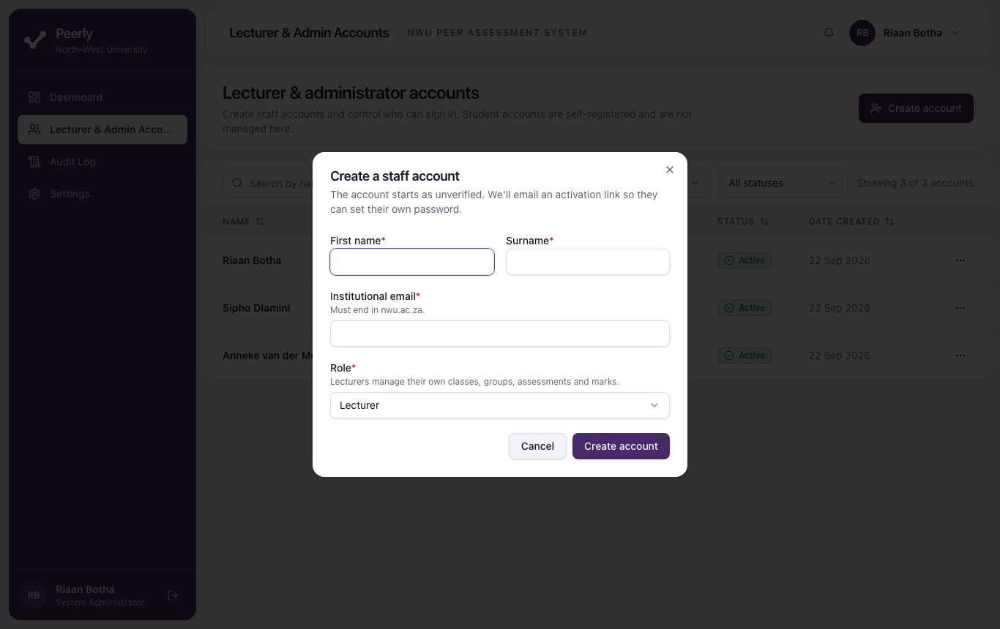
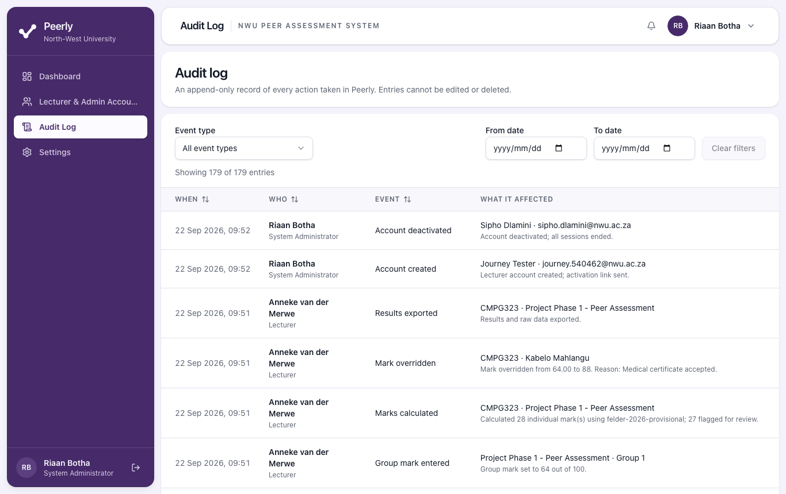
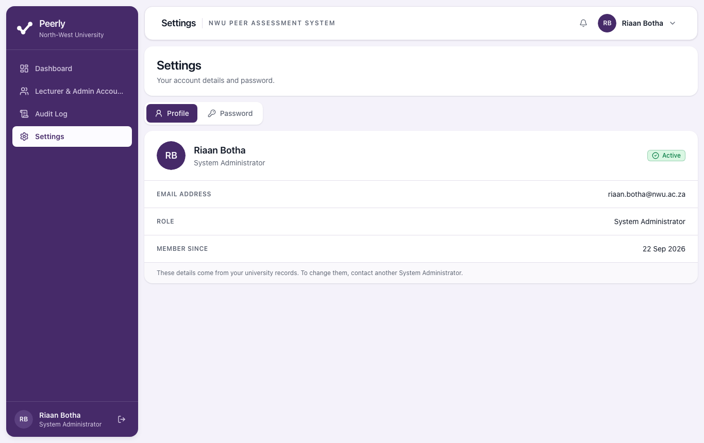

# Peerly System Administrator Guide

**Managing lecturer and administrator accounts**

| | |
| --- | --- |
| Audience | NWU staff who hold the **System Administrator** role in Peerly |
| Covers | Signing in, creating and editing staff accounts, activating and deactivating them, the audit log, troubleshooting |
| Requirement | OR-25 (electronic user guide: System Administrator) |

> The screenshots come from a test system with made-up accounts.

---

## Contents

1. [What a System Administrator does](#1-what-a-system-administrator-does)
2. [Your first sign-in](#2-your-first-sign-in)
3. [Signing in and out](#3-signing-in-and-out)
4. [The Administrator dashboard](#4-the-administrator-dashboard)
5. [Finding an account](#5-finding-an-account)
6. [Creating a staff account](#6-creating-a-staff-account)
7. [Editing details and changing a role](#7-editing-details-and-changing-a-role)
8. [Deactivating and reactivating an account](#8-deactivating-and-reactivating-an-account)
9. [Account statuses](#9-account-statuses)
10. [The audit log](#10-the-audit-log)
11. [Your own settings and password](#11-your-own-settings-and-password)
12. [Helping lecturers and students](#12-helping-lecturers-and-students)
13. [Messages you might see and what they mean](#13-messages-you-might-see-and-what-they-mean)
14. [Known limitations in the current version](#14-known-limitations-in-the-current-version)
15. [Frequently asked questions](#15-frequently-asked-questions)

---

## 1. What a System Administrator does

Peerly has three kinds of user:

| Role | Who | Account created by |
| --- | --- | --- |
| **System Administrator** | Staff who manage Peerly's staff accounts | Another System Administrator (the first one is set up when Peerly is installed) |
| **Lecturer** | Staff who run classes and peer assessments | A System Administrator |
| **Student** | Students rating their group | The student, by registering |

As a System Administrator you:

- create **lecturer** and **administrator** accounts
- correct their names and roles, and the email address of an account that hasn't been
  activated yet
- send a new activation link to someone whose link expired or went missing
- **deactivate** accounts that should no longer have access, and **reactivate** them
- read the **audit log** of everything that happens in Peerly

You **don't**:

- manage student accounts (students register themselves, and their lecturer links them to a
  class)
- see classes, groups, assessments, ratings or results in the portal. Peerly refuses those
  pages to administrators by design.
- know anyone's password. New staff choose their own password from an activation link.

Nobody can choose their own role or promote themselves. Only a System Administrator can create or
change a staff role.

---

## 2. Your first sign-in

The **first** System Administrator account is created when Peerly is installed. How that's done,
and how its initial credentials are handed over and changed, is covered in the *Technical Handover
Guide*. Change the initial password as soon as you first sign in (see [section
11](#11-your-own-settings-and-password)).

If another administrator created your account, you'll receive the **"Set up your Peerly
account"** email:

1. Open the link within **24 hours**.
2. On **Set your password**, choose a password and confirm it. The checklist shows the rules:
   **At least 8 characters**, **Not a commonly used password** and **Doesn't contain your email
   or student number**.
3. Select **Set password and activate**. When you see **Your account is active**, select **Go to
   sign in**.

---

## 3. Signing in and out

1. Open Peerly. Under the **I'm a student** and **I'm a lecturer** cards on **Welcome to
   Peerly** is a slimmer block, **I'm an administrator**. Select it.
2. Enter your `@nwu.ac.za` **Email address** and **Password** on **Administrator sign in**,
   then select **Sign in**.
3. Peerly opens the Administrator portal.

- Each sign-in form accepts only its own kind of account, and Peerly enforces this on the
  server, not only on the screen. An administrator who signs in on the lecturer form is told
  *"This is an administrator account. Use the administrator sign-in."*, with a link to it, and
  is not signed in. Lecturers and students on the wrong form get the same kind of message.
  This message only appears after the password has been checked, so it tells someone who
  doesn't know the password nothing.
- Any other failed sign-in always says *"Those details don't match an active Peerly account.
  Please check and try again."*, whatever the reason.
- **5 wrong passwords in a row** lock the account for **15 minutes**.
- Sessions end after **30 minutes without activity** and after **12 hours** in any case.
- To sign out, use the icon beside your name at the bottom of the left-hand menu, or the menu
  under your name at the top right.

---

## 4. The Administrator dashboard

The left-hand menu has **Dashboard**, **Lecturer & Admin Accounts**, **Audit Log** and
**Settings**.

The **Administrator dashboard** shows:

| Card | Meaning |
| --- | --- |
| **Lecturer accounts** | Number of lecturers, and underneath, how many administrator accounts exist |
| **Active** | Staff accounts that can sign in right now |
| **Deactivated** | Sign-in blocked, history kept |
| **Awaiting activation** | Invitation sent, not yet accepted |

**Recent account activity** lists the latest six account events (created, changed, activation
link resent, activated, deactivated), with who made each change. **Full audit log** and **Manage accounts** take you to
those pages.

---

## 5. Finding an account

Go to **Lecturer & Admin Accounts**. The page is titled **Lecturer & administrator accounts**.

- **Search by name or email** filters as you type.
- **All roles** narrows the list to **Lecturer** or **System Administrator**.
- **All statuses** narrows it to **Active**, **Deactivated** or **Unverified**.
- **Showing N of M accounts** tells you how much is filtered out. If nothing matches, select
  **Clear filters**.
- Select a column heading (**Name**, **Email**, **Role**, **Status** or **Date created**) to
  sort. On a tablet or phone the **Email** and **Date created** columns are left out to keep
  **Status** and the actions in view; the email address then shows under the name.
- The **…** button at the end of each row opens that account's actions.

Student accounts never appear here.

---

## 6. Creating a staff account

1. On **Lecturer & Admin Accounts**, select **Create account**.
2. Fill in **Create a staff account**:
   - **First name** and **Surname**
   - **Institutional email**, which must end in `nwu.ac.za` (for example
     `name.surname@nwu.ac.za`)
   - **Role**: **Lecturer** or **System Administrator**. The hint underneath reminds you that
     *"Administrators manage staff accounts only - they cannot see marks"* and *"Lecturers
     manage their own classes, groups, assessments and marks."*
3. Select **Create account**.

What happens next:

- The account appears with status **Unverified**.
- Peerly emails the person **"Set up your Peerly account"**, with a link valid for **24
  hours**.
- They open the link, choose their own password and are signed in. Their status becomes
  **Active**.
- The creation is recorded in the audit log as *Account created*.

A message confirms *"Account created. An activation link has been sent to …"*. The link itself
is only ever in the email sent to the new user; you never see it.

Tell the person to expect the email and to check their junk folder.

### Sending the activation link again

If the link has expired, landed in a junk folder or been deleted:

1. Find the account (its status is **Unverified**), select **…**, then **Resend activation
   link**.
2. A message confirms *"A new activation link has been sent to …"*.

The new link is valid for another **24 hours**, and **any earlier link stops working**, so only
the newest email can be used. The resend is recorded in the audit log as *Activation link
resent*.

**Resend activation link** is only offered for **Unverified** accounts. An account that is
already **Active** doesn't need one: its holder uses **Forgot password?** on the sign-in form.
A **Deactivated** account has to be reactivated first.

---

## 7. Editing details and changing a role

1. Find the account, select **…**, then **View / edit details**.
2. The **Account details** dialog shows the name, email and role, plus when the account was
   created and its current status.
3. Change what you need and select **Save changes**.

- **The email address can only be corrected before the account is activated.** On an
  **Unverified** account, correcting the address sends a new activation link to the new address,
  and the link sent to the old address stops working.
- **Once an account is activated, its email address can't be changed.** The field is locked
  with the hint *"Can't be changed on an activated account…"*, and Peerly refuses the change on
  the server too. The reason: password resets go to that address, so whoever held a new address
  could reset the password and take the account over. If someone's address really changes,
  create a new account for the new address, then deactivate the old one.
- **Changing the role** between **Lecturer** and **System Administrator** takes effect the next
  time they load a page.
- Every change to the name, surname, email address or role is recorded in the audit log as
  *Account changed*, with the old and new values.
- You **can't demote the last active System Administrator**. Peerly refuses with *"This is the
  only active administrator. Make someone else an administrator first."*

---

## 8. Deactivating and reactivating an account

Deactivate an account when someone leaves, changes post, or should no longer have access.
Deactivation **doesn't delete anything**. The person's classes, assessments and audit history
are kept.

### Deactivate

1. Find the account, select **…**, then **Deactivate account**.
2. Check the confirmation **Deactivate this account?**. It names the person and says: *"They will
   be signed out and will not be able to sign in again until the account is reactivated. Their
   classes, assessments and audit history are kept."*
3. Select **Deactivate account**.

The effect is immediate: **every session they have open is ended at once**.

### Reactivate

1. Filter **All statuses** to **Deactivated**, find the account, select **…**, then **Activate
   account**.
2. Confirm **Activate this account?** (*"They will be able to sign in again immediately with their
   existing password."*).

An account that was deactivated before its holder ever activated it goes back to **Unverified**
rather than **Active**, because nobody has set a password on it yet. Use **Resend activation
link** to send them a working link.

### The last administrator is protected

If you try to deactivate the only System Administrator who can still sign in, Peerly shows **This
account can't be deactivated**: *"This is the only System Administrator who can still sign in.
Deactivating it would lock everyone out of account administration."* Select **Create an
administrator** to add another first, then try again.

### Unverified accounts

An **Unverified** account has no **Activate account** option. Only the account holder can
activate it, by using the link they were emailed. This also proves the email address is really
theirs. Its menu offers **Resend activation link** instead (see [section
6](#sending-the-activation-link-again)).

---

## 9. Account statuses

| Status | Meaning | Can sign in? |
| --- | --- | --- |
| **Unverified** | Created, but the holder hasn't used their activation link yet | No |
| **Active** | Normal working account | Yes |
| **Deactivated** | Blocked by an administrator. Nothing deleted. | No |

---

## 10. The audit log

**Audit Log** is a permanent record of every action in Peerly. **Entries can't be edited or
deleted by anyone**, including you, and they're kept even when the thing they describe (a class,
say) is later deleted.

- Columns: **When**, **Who** (name and role), **Event** and **What it affected** (with a short
  detail line).
- Filter by **Event type**, **From date** and **To date**. **Clear filters** resets them.
  **Showing N of M entries** tells you how much is filtered out.
- As an administrator you see the **whole system's** trail. Lecturers see only their own
  classes.

Event types you'll see:

| Group | Events |
| --- | --- |
| Accounts | Account created, Account changed, Activation link resent, Account activated, Account deactivated, Password changed |
| Classes | Class created, Class list imported, Match conflict resolved, Groups confirmed, Class deleted |
| Assessments | Assessment created, Assessment changed, Assessment opened, Assessment closed, Assessment re-opened, Reminders sent, Assessment deleted |
| Marks | Group mark entered, Marks calculated, Mark overridden, Results exported |

> **Confidentiality.** Some entries describe lecturers' marking. For example, *Group mark
> entered* includes the mark, and *Mark overridden* includes the student's name, both marks and
> the lecturer's reason. Look at these only when you need to for an audit or investigation, and
> never share them. See also [Known
> limitations](#14-known-limitations-in-the-current-version).

Passwords, codes and links are never written to the audit log.

---

## 11. Your own settings and password

Go to **Settings**.

- **Profile** shows your name, email, role, status and the date you joined. You can't edit your
  own profile. Ask another System Administrator.
- **Password:** enter your **Current password**, then a **New password** twice, and select
  **Change password**. This signs you out on every other device.

---

## 12. Helping lecturers and students

| Problem | What to do |
| --- | --- |
| A lecturer never received the activation email | Ask them to check their junk folder. Confirm the email address on their account is correct (**View / edit details**); correcting it sends a new link. Otherwise select **…** → **Resend activation link**. |
| A lecturer's activation link has expired (older than 24 hours) | Select **…** → **Resend activation link**, or they can select **Send me a new link** on the page the old link opens. The earlier link stops working. |
| A lecturer forgot their password | They select **Forgot password?** on the sign-in form. The reset link is valid for one hour. You can't reset passwords for them. |
| A lecturer is locked out after wrong passwords | Ask them to wait 15 minutes, or reset their password. |
| A lecturer's name is wrong | Correct it in **View / edit details**. |
| A lecturer's email address is wrong or has changed | Before activation, correct it in **View / edit details**. After activation it can't be changed: create a new account for the right address, then deactivate the old one. |
| A lecturer changed posts, or a new lecturer takes over a module | Classes belong to the lecturer who created them, and Peerly has no screen to transfer a class. Contact support. |
| Someone has left | **Deactivate account**. Their data is kept. |
| A student can't register or sign in | Students help themselves: **Register here**, **Resend code** and **Forgot password?**. A student who didn't finish verifying can simply register again with the same details. The student number must be the one in their student email address (`12345678@mynwu.ac.za` goes with student number `12345678`); Peerly refuses a registration where the two don't match. |
| Someone is told to use a different sign-in | They picked the wrong card on **Welcome to Peerly**. Each sign-in form only admits its own kind of account, and the message links to the right one. |
| A student's account "isn't linked to a class" | This is for the student's **lecturer**, who manages the class list and match conflicts. |

---

## 13. Messages you might see and what they mean

| Message | Meaning | What to do |
| --- | --- | --- |
| *Enter the person's first name.* / *Enter the person's surname.* | A required field is empty. | Fill it in. |
| *Staff accounts must use an institutional address ending in nwu.ac.za.* / *Use an institutional address ending in @nwu.ac.za.* | Not a staff address. | Use the person's `@nwu.ac.za` address. |
| *This doesn't look like an email address…* | Typing error. | Correct the address. |
| *An account already uses that email address.* | That address already has an account (perhaps **Deactivated** or **Unverified**). | Search for it. Reactivate or edit it instead of creating a new one. |
| *The email address of an account that has been activated can't be changed…* | You tried to change an activated account's address. | Create a new account for the new address, then deactivate this one. |
| *This account is already active. Ask its holder to use "Forgot password" instead.* | You tried to resend an activation link to an **Active** account. | The holder uses **Forgot password?** on the sign-in form. |
| *This account is deactivated. Reactivate it first.* | You tried to resend an activation link to a **Deactivated** account. | Reactivate it, then resend. |
| *This is an administrator account. Use the administrator sign-in.* (or *lecturer* / *student*) | The right password, on the wrong sign-in form. Nobody is signed in. | Use the link in the message, or go back to **Welcome to Peerly** and pick the right card. |
| *This is the only active administrator. Make someone else an administrator first.* | You tried to demote the last active administrator. | Create or promote another administrator first. |
| **This account can't be deactivated** | You tried to deactivate the last active administrator. | Select **Create an administrator** first. |
| *This account hasn't been activated yet. Its holder needs to use the link they were emailed.* | You tried to activate an **Unverified** account. | The holder must use their email link. |
| *Those details don't match an active Peerly account.* | Sign-in failed (wrong details, not activated, deactivated or locked). | Check the account's status on **Lecturer & Admin Accounts**. |
| *Too many attempts. Please wait a few minutes and try again.* | Too many sign-in or email requests from one network in a short time. | Wait a few minutes. |
| *Something went wrong on our end. Please try again.* | Unexpected error. The details are logged for support. | Try again, then report it with the time. |

---

## 14. Known limitations in the current version

1. **The audit log shows marking details** (see [section 10](#10-the-audit-log)). Administrators
   can't open ratings or results pages, but audit entries about marking are visible to them.
2. **Classes can't be transferred** between lecturers.
3. **An activated account's email address can't be changed** (see [section
   7](#7-editing-details-and-changing-a-role)). This is deliberate: create a new account for the
   new address instead.

---

## 15. Frequently asked questions

**Can I see students' ratings or marks?**
No. The lecturer portal pages refuse administrator accounts. The audit log does record marking
events (see [section 10](#10-the-audit-log)). Treat those as confidential.

**Can I delete an account?**
No. Deactivate it instead. Peerly keeps accounts so the audit trail and past results remain
explainable.

**Can I make myself a lecturer as well?**
An account has exactly one role. If you also teach, have a separate lecturer account created
with a different institutional address, or ask whether your role should change.

**Why can't I deactivate the only administrator?**
Peerly would have nobody left who could manage accounts. Create a second administrator first.
It's good practice to always have at least two active administrators.

**What happens to a deactivated lecturer's classes?**
Nothing. They're kept exactly as they were, including results and the audit history. Only
sign-in is blocked.

**Does deactivation take effect straight away?**
Yes. Every session the person has open is ended immediately.
