# Peerly Lecturer Guide

**Running a peer assessment cycle with Peerly**

| | |
| --- | --- |
| Audience | NWU lecturers who run group-project peer assessments |
| Covers | Classes and class lists, groups, assessments, monitoring, the evaluation matrix, marks, the Felder calculation, overrides, export, audit log |
| Requirement | OR-25 (electronic user guide: Lecturer) |

> **Marks are provisional for now.** Peerly calculates individual marks with the Felder method.
> The method, the rating scale and the factor limits are agreed. The **rounding rule** is still
> waiting for the Sponsor to approve the *Felder Calculation Specification* (assumption
> **AS-08**), so every calculation is stamped **`felder-2026.2-provisional`**.
> **Don't publish Peerly marks as final** until you've been told the specification is approved.
> See [How individual marks are calculated](#11-how-individual-marks-are-calculated).

> The screenshots come from a test system with made-up students.

---

## Contents

1. [The cycle at a glance](#1-the-cycle-at-a-glance)
2. [Getting your account and signing in](#2-getting-your-account-and-signing-in)
3. [Finding your way around](#3-finding-your-way-around)
4. [Classes and class lists](#4-classes-and-class-lists)
5. [Groups](#5-groups)
6. [Assessments](#6-assessments)
7. [Submission monitor](#7-submission-monitor)
8. [Evaluation matrix](#8-evaluation-matrix)
9. [Entering group marks](#9-entering-group-marks)
10. [Calculating marks](#10-calculating-marks)
11. [How individual marks are calculated](#11-how-individual-marks-are-calculated)
12. [Results and overrides](#12-results-and-overrides)
13. [Exporting to Excel](#13-exporting-to-excel)
14. [Audit log](#14-audit-log)
15. [Deleting a class or an assessment](#15-deleting-a-class-or-an-assessment)
16. [Messages you might see and what they mean](#16-messages-you-might-see-and-what-they-mean)
17. [Known limitations in the current version](#17-known-limitations-in-the-current-version)
18. [Frequently asked questions](#18-frequently-asked-questions)

---

## 1. The cycle at a glance

A full peer-assessment cycle has eight steps. Each has its own page in the left-hand menu.

| Step | What you do | Where |
| --- | --- | --- |
| 1 | Create the class and import its class list | **Classes** |
| 2 | Generate groups, adjust them, and confirm | **Groups** |
| 3 | Create an assessment and choose the groups taking part | **Assessments** |
| 4 | Open the assessment to students | **Assessments** > the assessment |
| 5 | Watch submissions come in, then close the assessment | **Submission Monitor**, then the assessment page |
| 6 | Review who rated whom | **Evaluation Matrix** |
| 7 | Enter each group's mark, then calculate | **Marks & Calculation** |
| 8 | Review results, override where justified, and export | **Results & Export** |

Students register themselves (see the *Student Guide*). Peerly links each registered student to
your class list by **student number**.

---

## 2. Getting your account and signing in

### Your account

You can't register as a lecturer. A **System Administrator** creates your account, and Peerly
emails you **"Set up your Peerly account"**.

1. Open the link in the email within **24 hours**.
2. On **Set your password**, choose a password and enter it again under **Confirm password**.
   A checklist shows the rules as you type:
   - **At least 8 characters**
   - **Not a commonly used password**
   - **Doesn't contain your email or student number**
3. Select **Set password and activate**. When you see **Your account is active**, select **Go to
   sign in**.

If the link has expired you'll see **This link has expired**. Ask your System Administrator to
help. (The **Send me a new link** button on that page only tells you to contact them.)

### Signing in

1. Open Peerly. On **Welcome to Peerly**, choose **I'm a lecturer**, then **Continue**.
2. Enter your NWU **Email address** (`name.surname@nwu.ac.za`) and **Password**, then select
   **Sign in**.

- A failed sign-in always shows the same message: *"Those details don't match an active Peerly
  account. Please check and try again."*
- After **5 wrong passwords in a row**, your account is locked for **15 minutes**.
- Peerly signs you out after **30 minutes without activity**, and after **12 hours** in any
  case. If pages stop loading, refresh and sign in again.
- **Forgot password?** on the sign-in form emails you a reset link that's valid for **one
  hour**.
- To change your password, go to **Settings** > **Password**. You'll need your current
  password. Changing it signs you out on your other devices.
- To sign out, use the icon next to your name at the bottom of the menu, or open the menu under
  your name at the top right.

---

## 3. Finding your way around

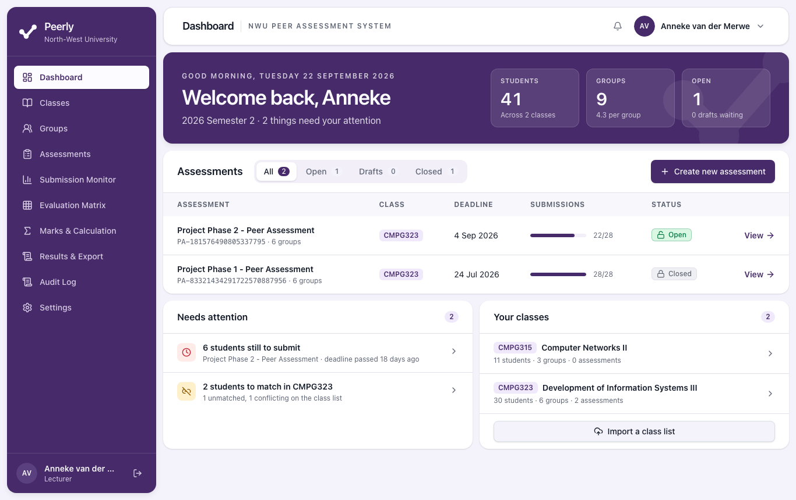

- **Left-hand menu:** **Dashboard**, **Classes**, **Groups**, **Assessments**, **Submission
  Monitor**, **Evaluation Matrix**, **Marks & Calculation**, **Results & Export**, **Audit Log**
  and **Settings**.
- **Active class and Active assessment:** the two drop-downs at the top of every page. **Every
  page works on the class and assessment selected here.** If a page looks empty or shows the
  wrong data, check these first. Peerly remembers your choice on this device.
- **Notifications (bell icon):** not in use yet. It's always empty.

### Dashboard

- **Welcome back** banner with totals: **Students**, **Groups** and **Open** assessments.
- **Assessments** list with tabs for **All**, **Open**, **Drafts** and **Closed**, each showing
  its deadline and submission progress. **Create new assessment** is at the top of the list.
- **Needs attention** lists, most urgent first:
  - open assessments with students still to submit (*"… still to submit"*)
  - classes with students to match (*"… to match in CMPG323"*)
  - drafts waiting to be opened (*"Draft waiting to open"*)

  Select an item to go straight to it.
- **Your classes** lists every class you own.

---

## 4. Classes and class lists

### 4.1 Create a class

1. Go to **Classes** and select **New class**.
2. Fill in **Create a class**:
   - **Module code:** 4 letters and 3 digits, for example `CMPG323`
   - **Class name:** as students know it
   - **Academic period:** this year or next, Semester 1 or 2
3. Select **Create class**. You become the responsible lecturer, and Peerly takes you straight
   to the import.

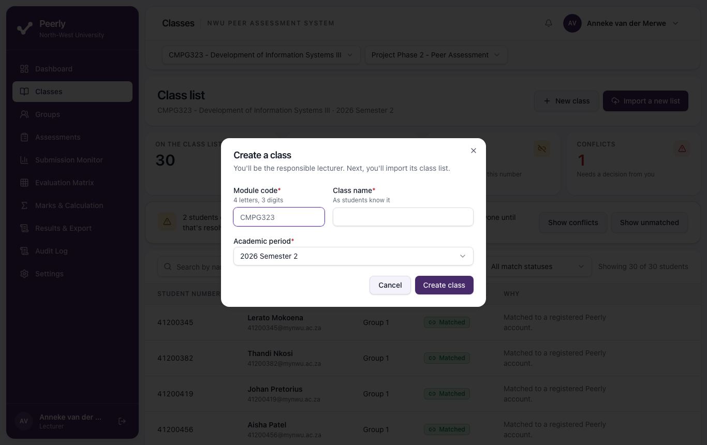

You can't create the same module code twice in the same academic period: *"CMPG323 already
exists for 2026 Semester 2. Use a different module code or academic period."*

> **First class ever?** With no classes yet, every lecturer page shows **You don't have any
> classes yet** with a **Create a class** button, which opens the same form.

### 4.2 Prepare the class list file

- **Format:** `.csv` or `.xlsx`, **5 MB** at most, and no more than **2,000 rows**. The older
  `.xls` format isn't accepted. Save it as `.xlsx` or `.csv` first.
- **The first row holds the column headings.** Include these columns (the names can vary, and you
  map them in the next step):
  - **Student number:** 8 digits
  - **First name**
  - **Surname**
  - **Institutional email:** recommended
- Other columns are ignored.
- Any formulas in the file are never run. Peerly reads the last value Excel saved.

### 4.3 Import the class list

Go to **Classes** > **Import a new list**. The import has four steps shown across the top: **Upload
the file**, **Confirm the columns**, **Check the rows** and **Import**. Nothing changes until the
last step.

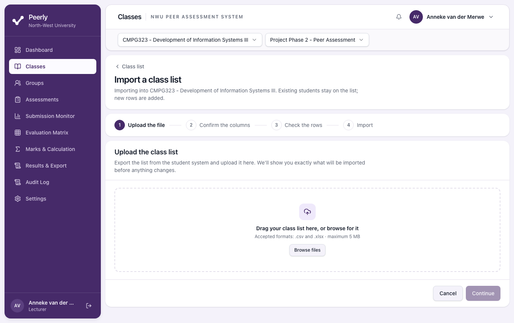

1. **Upload the file.** Drag your file onto the box, or select **Browse files**, then select
   **Continue**.
2. **Confirm the columns.** Peerly suggests which heading in your file matches each Peerly
   field. Check every drop-down and correct any wrong guess, then select **Continue**. Each
   column can be used only once.
3. **Check the rows.** The summary says, for example, *"27 rows ready to import, 2 with
   errors"*. Every row is listed with a **Status** of **Ready**, or with the reason it failed:

   | Reason shown | Fix |
   | --- | --- |
   | *No student number in this row.* | Add the number. |
   | *"4120034" is not an 8-digit student number.* | Correct the number. |
   | *41200345 already appears on row 7.* | Remove the duplicate row. |
   | *No first name in this row.* / *No surname in this row.* | Fill in the name. |

   **Rows with errors are skipped. The rest are imported.** To include a skipped row, fix the
   file and select **Upload a different file**.
4. Select **Import N students**, check the confirmation (**Import this class list?**), then
   select **Import class list**. A message reports how many students were imported, how many
   were matched to an account, and how many are still unmatched.

**Importing again adds to the list.** Existing students stay, new rows are added, and students
already on the list have their names and emails updated from the file. Students already in a
confirmed group keep their group.

### 4.4 Match statuses

Peerly links each row to a registered student account with the same student number. The
**Class list** page shows counts for **On the class list**, **Matched**, **Unmatched** and
**Conflicts**, and a table you can search by name or student number and filter by match status.

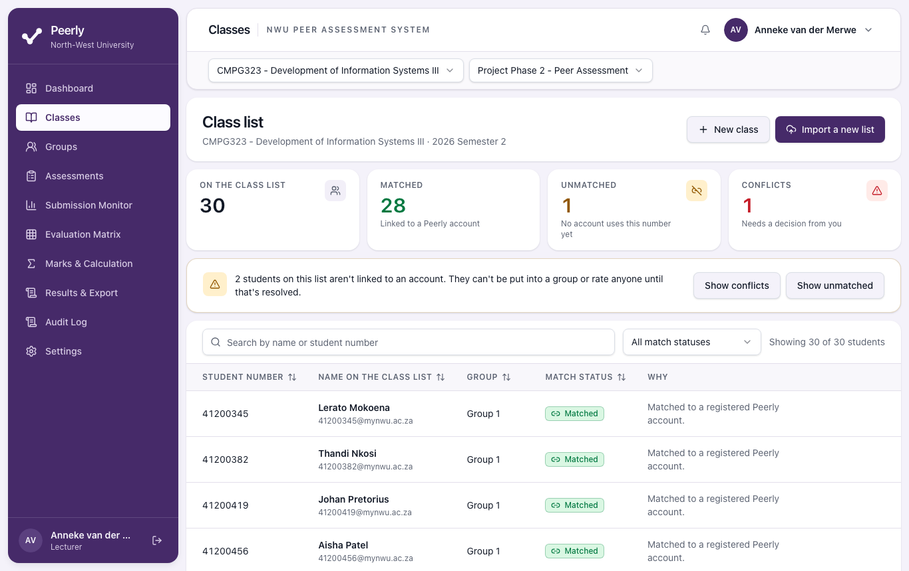

| Status | Meaning | Can they be grouped and rate? |
| --- | --- | --- |
| **Matched** | *"Matched to a registered Peerly account."* | Yes |
| **Unmatched** | *"No registered Peerly account uses this student number yet."* | No |
| **Conflict** | An account uses this number, but its name differs from the class list. You need to decide. | No |

When anyone is unmatched or in conflict, a banner says they *"can't be put into a group or rate
anyone until that's resolved"*, with **Show conflicts** and **Show unmatched** buttons.

**Students can register before or after you import.** Peerly matches a student the moment
they confirm their email address, and again every time you import the list, so the order
doesn't matter. A student only matches automatically when both their surname and their first
name agree with the class list. Differences in capitals, spaces or hyphens are ignored. If the
names differ, the row becomes a **Conflict** for you to check, because that is exactly what
someone using another student's number would look like.

### 4.5 Resolve a conflict

1. On **Classes**, find the row marked **Conflict** and select **Resolve**.
2. **Resolve this conflict** shows the class-list entry beside every registered account using
   that number. Accounts whose surname differs are marked *Surname differs from the class list*.
3. Choose one:
   - Select the right account, then **Link this account**. That student can now take part in
     the class.
   - Select **Leave unmatched** if none of them is the right person.
4. Your decision is recorded in the audit log.

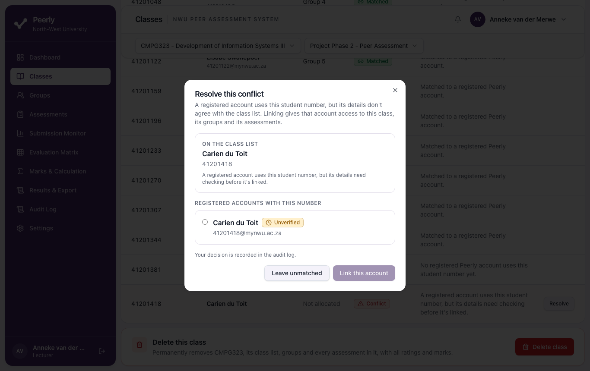

Linking gives that account access to the class, its groups and its assessments. Only link an
account if you're sure it's the right student.

---

## 5. Groups

### 5.1 Generate groups

1. Go to **Groups** and select **Generate groups** (or **Edit groups** if the class already has
   groups).
2. Under **How should the groups be built?**, choose one:
   - **Number of groups**, then enter **How many groups?**
   - **Target group size**, then enter **Students per group**

   The hint underneath shows the other figure, for example *About 5 students per group*.
3. Select **Generate groups**. Only **matched** students are allocated. The page header says how
   many are available.

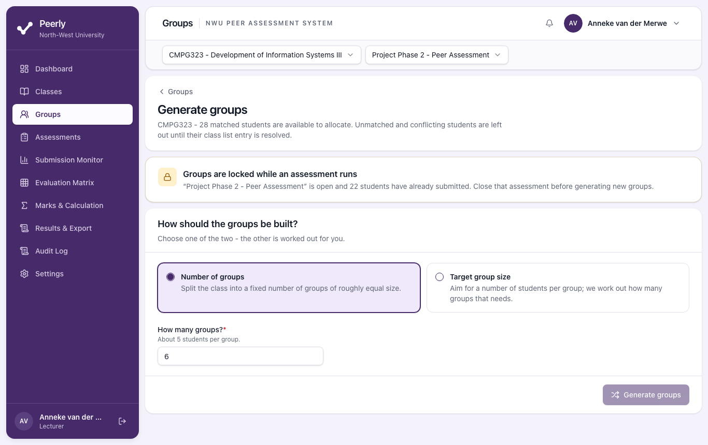

Students are dealt into groups one at a time in student-number order, so group sizes never
differ by more than one. For example, 13 students in 4 groups gives 4, 3, 3 and 3. Selecting
**Generate again** with the same settings produces the same groups. Use **Move to** to change
them.

### 5.2 Review and adjust

- Every proposed group lists its members. Use the **Move to** drop-down beside a student to put
  them in another group.
- A group with fewer than 2 members is marked *Too small to run a peer assessment*, and **Confirm
  these groups** stays disabled until you fix it.
- Nothing is saved until you confirm.

### 5.3 Confirm

1. Select **Confirm these groups**, check **Confirm these groups?**, then select **Confirm
   groups**.
2. **Confirming replaces all of the class's current groups.** Any assessment that used the old
   groups loses them. After regrouping, open each **draft** assessment's **Edit setup** and
   select its groups again.

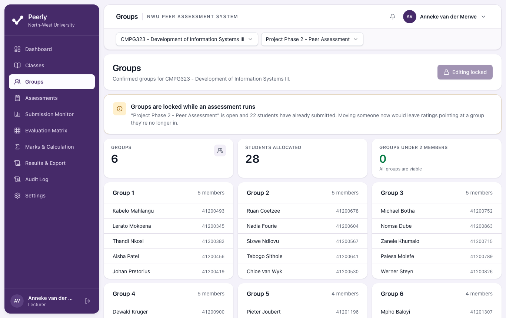

### 5.4 When groups are locked

Once students have started submitting, changing groups would leave ratings pointing at groups
people are no longer in, so Peerly stops you:

- While an **open** assessment has submissions, **Groups** shows **Editing locked** and the
  banner **Groups are locked while an assessment runs**.
- The rule also covers **closed** assessments. If *any* opened assessment in the class has
  submissions, confirming new groups is refused with *"'[assessment]' already has submissions,
  so the groups it was set up with can't be changed."* This applies even after you close the
  assessment, despite what the on-screen hint says.

---

## 6. Assessments

### 6.1 Create an assessment

1. Go to **Assessments** and select **New assessment**, or **Create new assessment** on the
   Dashboard.
2. **Details**
   - **Assessment name:** use one your students will recognise
   - **Description** (optional): shown to students on their dashboard and at the top of the
     form
   - **Class:** fixed to the class you're working in
3. **Groups taking part:** tick the groups, or use **Select all**. Students in groups you leave
   out won't see the assessment. If the class has no groups yet, you'll see *This class has no
   confirmed groups yet. Generate groups first.*
4. **When it runs**
   - **Opens** and **Closes** (date and time). **Closes** must be after **Opens**.
   - **Group mark is out of:** usually `100`. Group marks and overrides can't exceed this
     number.
5. The **Rating scale** panel shows the nine options students choose from. It's the same for
   every assessment and can't be edited.
6. Select **Save as draft**. Nothing is visible to students yet.

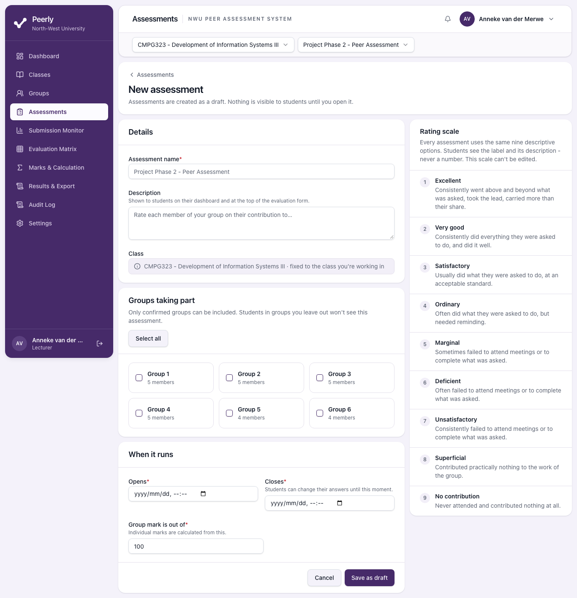

### 6.2 The assessment page

Select **View** next to an assessment on **Assessments** to open its page. It shows the status
(**Draft**, **Open** or **Closed**), the counts for **Groups**, **Students**, **Submitted** and
**Marks calculated**, a submission progress bar, and **Where to next** links.

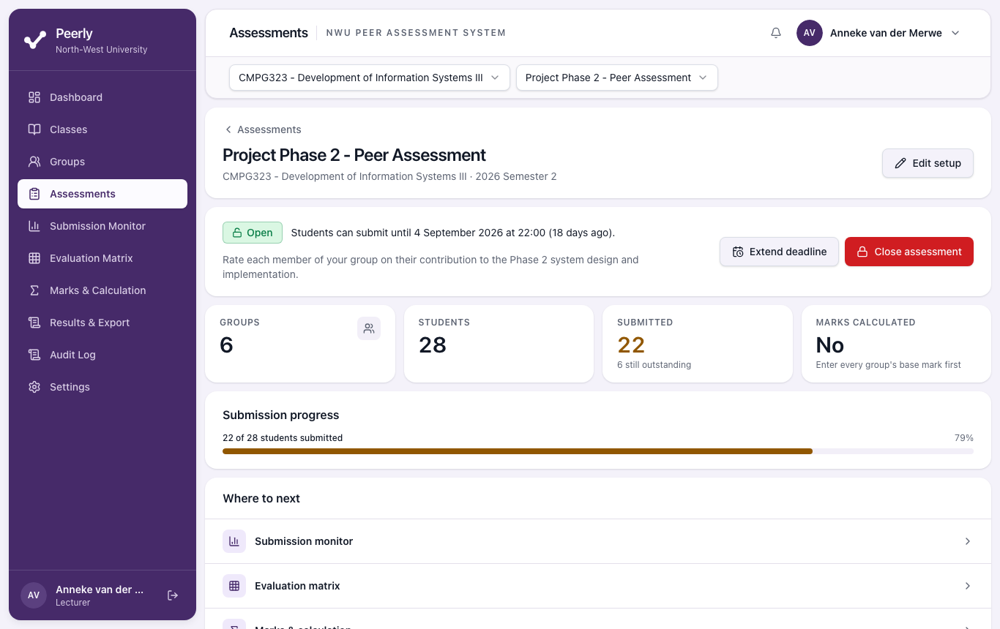

| Button | Available when | What happens |
| --- | --- | --- |
| **Open to students** | Draft | Confirms with **Open this assessment to students?**, then **Open assessment**. Students in the selected groups can rate immediately. |
| **Extend deadline** | Open | Choose a **New closing date and time** later than the current one, then select **Extend deadline**. Students who already submitted keep their submission and can still amend it. |
| **Close assessment** | Open | Confirms with **Close this assessment now?** and says how many students haven't submitted. After closing, nobody can submit or change ratings. |
| **Re-open** | Closed | Confirms with **Re-open this assessment?** Students can submit and amend again. **If marks were already calculated, re-opening invalidates them**, and you'll need to calculate again. |
| **Edit setup** | Any time | Opens the form with **Save changes**. |

> **Opening and closing are manual.** The **Opens** and **Closes** times are shown to students,
> but Peerly **doesn't open or close the assessment automatically**. Select **Open to students**
> when you want it to start and **Close assessment** when you want it to end. Until you close
> it, students can still submit after the closing time has passed.
>
> **Re-opening after the closing date:** re-open first, then select **Extend deadline** so the
> date shown to students is in the future.

### 6.3 Editing after opening

The edit page warns **This assessment is already open** (or **closed**). You can still change
the name, description, dates and maximum mark. Once an assessment has opened, Peerly **refuses
changes to its groups**. If it can't save, you'll see *"We couldn't save this assessment. Please
try again."* Undo the group change and save again.

---

## 7. Submission monitor

Go to **Submission Monitor** (with the assessment selected in the header).

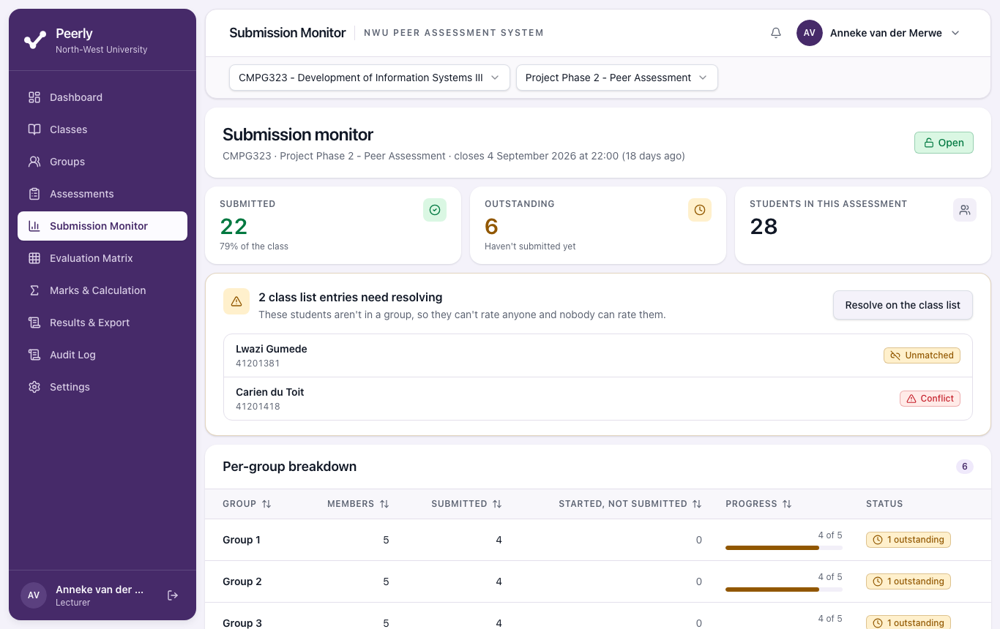

- **Submitted**, **Outstanding** and **Students in this assessment**, with the percentage
  submitted.
- **Class list entries need resolving:** unmatched or conflicting students, who aren't in a group
  and so can't rate or be rated. Select **Resolve on the class list** to fix them.
- **Per-group breakdown:** each group's **Members**, **Submitted**, **Progress** and **Status**
  (**Complete** or *N outstanding*).
- **Outstanding students:** everyone who hasn't submitted, with their student number and group.

**Send reminder** is shown but **doesn't send any email yet**. Contact outstanding students
through your usual channels. See [Known limitations](#17-known-limitations-in-the-current-version).

---

## 8. Evaluation matrix

Go to **Evaluation Matrix** and choose a **Group** at the top right. Switching groups doesn't
reload the page.

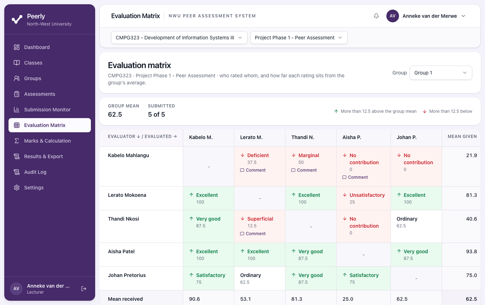

How to read it:

- **Rows are the students who gave the ratings** (evaluators). **Columns are the students
  being rated.** A student doesn't rate themselves, so their own cell shows **-**.
- Each cell shows the **descriptive label** and, underneath, the **scale value** behind it
  (for example *Very good 94*). **Scale values are shown only to lecturers.** Students never
  see them.
- **Mean given** (last column) is the average of the ratings that student handed out.
- **Mean received** (bottom row) is the average each student received. The bottom-right figure
  and **Group mean** at the top are the average of all ratings in the grid.
- A rating **5 or more above** the group mean (one step on the scale) is shaded green with an up
  arrow. One **5 or more below** is shaded red with a down arrow. The arrow means you can tell them apart without
  relying on colour.
- A student who **didn't submit** has a shaded row marked **Did not submit**, and their cells
  say **Not rated**. These cells are **not** counted as zero.
- **Comment** under a cell opens the evaluator's comment.
- Badges under a student's name, and the **Flags in this group** panel, show [result
  flags](#115-result-flags) once marks have been calculated.

---

## 9. Entering group marks

Go to **Marks & Calculation**. Enter the mark each group earned **for the work itself**.

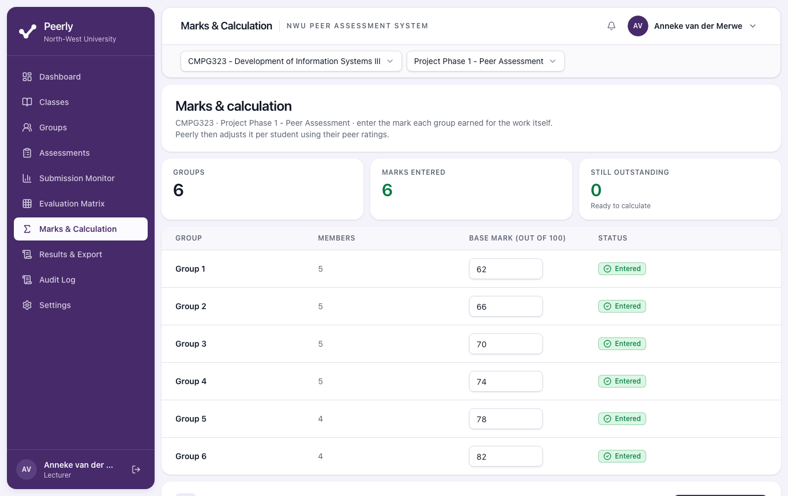

1. Type each group's mark in **Base mark (out of 100)** (or whatever the assessment is out of).
2. The mark saves automatically when you leave the box. **Status** shows **Saving…**, then
   **Saved**, then **Entered**.
3. Rules:
   - a number from 0 up to the maximum
   - whole numbers or **one** decimal place (for example `74.5`)
   - an empty box means *not entered yet* (**No mark yet**), which is different from `0`
4. The counts at the top show **Marks entered** and **Still outstanding**.

---

## 10. Calculating marks

1. When every group has a mark, the panel says **Every group has a base mark** and **Calculate
   marks** becomes available. Until then it stays disabled, *"so nobody ends up with a mark of
   zero by accident."*
2. **Close the assessment first.** Peerly lets you calculate while an assessment is still open,
   but ratings can still change until you close it.
3. Select **Calculate marks**. The confirmation, **Calculate individual marks?**, lists the base
   mark used for each group. Select **Calculate marks** again.
4. Peerly takes you to **Results**.

**Calculating again** replaces the previous results for the assessment. Earlier runs stay on
record and each run has its own **calculation run id**.

If you've overridden any marks, the confirmation lists each one and asks what to do with them
before **Calculate marks** becomes available:

- **Keep them.** Each override stays in force, shown beside its new calculated mark.
- **Withdraw them.** The new calculated marks stand.

What happened to each override is recorded in the audit log.

---

## 11. How individual marks are calculated

This section explains what happens when you select **Calculate marks**, so you can check any
mark by hand and explain it to a student or a moderator.

> **Settings in this version.** The scale and limits are agreed. The rounding rule is still
> **provisional** until the Sponsor signs off the Felder Calculation Specification (AS-08).
>
> | Setting | Current value | Status |
> | --- | --- | --- |
> | Rule version stamped on each run | `felder-2026.2-provisional` | |
> | Rating scale | The banded scale in [11.1](#111-the-hidden-scale) | Agreed |
> | Lowest allowed adjustment factor | **0.6** | Agreed |
> | Highest allowed adjustment factor | **1.1** | Agreed |
> | Self-ratings | Not counted, and students can't rate themselves | Agreed |
> | Rounding of the final mark | **2 decimal places**, halves rounded away from zero | Provisional |
> | Factor when there's nothing to compare | **1** (the group mark, unchanged) | Provisional |
>
> Each calculation run saves the exact settings **and scale** it used, so an old mark can
> always be explained even if they change later. **Don't present these marks as final until
> AS-08 is approved.**

### 11.1 The hidden scale

Students only ever see descriptive labels. Each label stands for a band of marks and counts as
the **top of its band**. Only lecturers see the value, on the matrix, in the results drill-down
and in the export:

| Label | Band | Value used |
| --- | --- | --- |
| Excellent | 95 - 100 | 100 |
| Very good | 90 - 94 | 94 |
| Satisfactory | 85 - 89 | 89 |
| Ordinary | 80 - 84 | 84 |
| Marginal | 75 - 79 | 79 |
| Deficient | 70 - 74 | 74 |
| Unsatisfactory | 65 - 69 | 69 |
| Superficial | 60 - 64 | 64 |
| No contribution | 50 - 59 | 59 |

**The lowest rating still counts for 59.** This is the same compressed scale the Felder
spreadsheet uses, so one harsh rating moves a factor much less than it would on a 0-to-100
scale. In practice the **0.6 floor is never reached**. Even a student rated *No contribution*
by everyone, in a group where all the others are rated *Excellent*, gets a factor of about 0.66
in a group of four and 0.62 in a group of eight. The **1.1 ceiling does apply**: a student rated
*Excellent* in a weaker group can reach it.

### 11.2 The steps

For each group:

1. **Each student's mean received.** Average the values of the ratings the student received
   from their group members. Students never rate themselves, so there are no self-ratings to
   include.
2. **The group mean.** Average the members' means from step 1. Each member counts once. A member
   nobody rated is left out, rather than counted as zero.
3. **Adjustment factor = student's mean received ÷ group mean.** A factor of 1 means the student
   was rated exactly at the group's average.
4. **Apply the limits.** A factor below **0.6** is raised to 0.6, and one above **1.1** is
   lowered to 1.1. Peerly keeps the original, *unclamped* factor too, so you can see how far
   outside the limits it was.
5. **Individual mark = group base mark × adjustment factor.** Peerly keeps full precision up to
   this point.
6. **Round once, at the end,** to **2 decimal places**.

Because the factor never goes below 0.6 or above 1.1, no mark is ever negative. The highest
possible mark is 1.1 times the base mark, and a mark is never above the assessment's maximum.

**What the screens show.** The **Results** table shows the factor to 2 decimals (for example
*× 1.04*) and marks to 1 decimal. The stored mark is rounded to 2 decimals, and the exported
workbook has the full figures. If you check a mark by hand from the screen, a small difference
in the last decimal is only display rounding. Use the export for exact checks.

**A note on "group mean".** The matrix's **Group mean** is the average of *all* ratings in the
grid. The calculation's group mean (step 2) is the average of the *members' means*. They're the
same when everyone received the same number of ratings, but can differ slightly when someone
didn't submit. The export's **Group mean** column shows the figure the calculation used.

### 11.3 Worked example

A group of four (Anna, Ben, Chris and Dineo) with a **group base mark of 70** out of 100.
Everyone submitted. Rows are who gave the rating, columns are who received it:

| Evaluator ↓ / Rated → | Anna | Ben | Chris | Dineo |
| --- | --- | --- | --- | --- |
| **Anna** | - | Very good (94) | Satisfactory (89) | Deficient (74) |
| **Ben** | Very good (94) | - | Satisfactory (89) | Marginal (79) |
| **Chris** | Excellent (100) | Very good (94) | - | Deficient (74) |
| **Dineo** | Satisfactory (89) | Satisfactory (89) | Satisfactory (89) | - |

**Step 1, mean received:**

- Anna: (94 + 100 + 89) ÷ 3 = **94.33**
- Ben: (94 + 94 + 89) ÷ 3 = **92.33**
- Chris: (89 + 89 + 89) ÷ 3 = **89**
- Dineo: (74 + 79 + 74) ÷ 3 = **75.67**

**Step 2, group mean:** (94.33 + 92.33 + 89 + 75.67) ÷ 4 = **87.83**

**Steps 3 to 6:**

| Student | Factor (mean ÷ 87.83) | After limits (0.6 to 1.1) | Mark = 70 × factor | Final (2 decimals) |
| --- | --- | --- | --- | --- |
| Anna | 1.0740 | 1.0740 | 75.180 | **75.18** |
| Ben | 1.0512 | 1.0512 | 73.586 | **73.59** |
| Chris | 1.0133 | 1.0133 | 70.930 | **70.93** |
| Dineo | 0.8615 | 0.8615 | 60.304 | **60.30** |

What this example shows:

- **Nobody hits a limit.** On this scale that's normal: the factors stay between about 0.86 and
  1.07, and the difference between the strongest and weakest member is about 15 marks.
- **Dineo** was rated *Deficient* or *Marginal* by everyone and gets 60.30, about 10 marks below
  the group mark.
- Peerly works from the unrounded factor. If you multiply by the 4-decimal factor shown here, you
  may be a cent out in the last place. The export has the full figures.
- **Flags** (advisory only, see [11.5](#115-result-flags)): Dineo gets **Uniform rating** (he
  gave everyone *Satisfactory*), **Low contribution** (mean received of 79, *Marginal*, or less)
  and **Isolated outlier**. Anna also gets **Isolated outlier**, because Chris's *Excellent* is
  10 or more above the group mean.

### 11.4 Edge cases

| Situation | What Peerly does | Flag shown |
| --- | --- | --- |
| **A student didn't submit** | Their own mark is still calculated from what the others said about them. No penalty is applied, because whether non-submission is penalised is an academic decision, not Peerly's. | **Did not submit** |
| **Fewer than half the group submitted** | Calculated normally, but on thin evidence. | **Incomplete group** |
| **Nobody rated the student** (for example, nobody else in the group submitted) | No factor can be worked out, so the factor is **1** and they receive the **group mark unchanged**. | **Not peer assessed** |
| **Group of two** | Calculated normally, but each student's factor rests on one opinion. | **Group of two** |
| **Group of one** | Nobody to rate or compare with, so the factor is **1** and they get the group mark. (Peerly won't let you confirm a group this small, so this is rare.) | **Group of one** |
| **Everyone gave identical ratings** | Every mean equals the group mean, so every factor is exactly **1** and everyone gets the group mark. | **Uniform rating** on each student who gave all their members the same option |
| **The whole group rated everyone *No contribution*** | Every mean is 59, the same as the group mean, so every factor is **1** and everyone gets the group mark unchanged. Peerly also guards against a group mean of zero, which can't occur on the current scale. | **Uniform rating**, and **Low contribution** on everyone |
| **Base mark of 0** | Every member's mark is 0, whatever the ratings. | **Group mark of zero** |
| **Student not in any group** | No result. A mark can't be worked out without peers. Check the class list and groups. | (no row) |

### 11.5 Result flags

Flags point out results worth a second look. **They never change a mark.** You decide whether
to act, for example with an override. Hover over or select a flag badge to read its explanation.
The thresholds behind them are also provisional.

| Flag | Explanation shown in Peerly | When it appears (current settings) |
| --- | --- | --- |
| **Uniform rating** | This student gave every group member exactly the same rating, so their scores carry little information about who did what. | The student gave two or more ratings, all the same option. |
| **Reciprocal extremes** | This student and another member rated each other at opposite ends of the scale, which usually points to a dispute rather than a difference in contribution. | Two students' ratings of each other differ by 50 or more (for example *Excellent* one way and *Marginal* the other). |
| **Isolated outlier** | One evaluator rated this student far away from what everyone else in the group said. | At least one rating the student received is 25 or more away from the group mean. |
| **Incomplete group** | Fewer than half of this group submitted, so the ratings that did arrive are a weak basis for adjusting anyone's mark. | Fewer than half the members submitted. |
| **Low contribution** | On average the group rated this student Marginal or lower - they sometimes failed to attend or to complete what was asked. | Mean received of 79 (*Marginal*) or lower. |
| **Did not submit** | This student did not rate their group members before the assessment closed. | No submission from the student. |
| **Group of two** | With only two members, each student is rated once, so the mean is very sensitive to a single opinion. | Group has two members. |
| **Group of one** | This student has nobody else in their group, so there are no peer ratings to adjust their mark by. They receive the group mark unchanged. | Group has one member. |
| **Unmatched** | This student could not be matched to the imported class list, so their result may be incomplete. | The student's class-list entry isn't matched. |
| **Not peer assessed** | Nobody in the group rated this student, so there is no factor to apply. They receive the group mark unchanged, which is not a peer-assessed mark. | No ratings received (group of two or more). |
| **Group mark of zero** | This group's base mark is zero, so every member's mark is zero. Check it was entered deliberately. | Base mark is 0. |
| **Whole group rated lowest** | Every rating in this group was the lowest option, so no factor can be calculated. Every member receives the group mark unchanged. | Group mean is 0. |

---

## 12. Results and overrides

Go to **Results & Export**.

- **Summary cards:** **Submission rate**, **Mean adjustment factor** (*"1.00 means the group mark
  is unchanged"*), **Mean final mark** and **Flagged students** (*"Worth a look before you
  publish"*).
- **Table:** one row per student, showing **Student**, **Group**, **Mean received**,
  **Adjustment**, **Group mark**, **Final mark**, **Overridden** and **Flags**. Select a column
  heading to sort.
- **Filters:** **All students**, **Flagged only** or **Overridden only**, plus a group filter.
  **Showing N of M students** tells you how many rows are visible.
- If nothing has been calculated yet, you'll see **No results yet** with a link to **Go to marks
  & calculation**.

### 12.1 See the ratings behind a mark

Select a student's row to open the drill-down. It shows their **Mean received**, **Adjustment
factor**, **Group base mark** and **Final mark**, any flags, and **Ratings this student
received**: each evaluator's name, the label with its value, and any comment. If nobody rated
them, it says so.

### 12.2 Override a mark

Peerly calculates. **You remain the assessor of record.** If there's a good reason, such as a
medical certificate or a documented dispute, you can override a mark.

1. Open the student's drill-down and select **Override mark**.
2. **Override this student's mark** shows the **Calculated mark** and how it was worked out
   (*group mark × adjustment*).
3. Enter the **New mark**.
4. Enter a **Reason for the override**. It's required, and **Save override** stays disabled
   until you give one. Write it so it still makes sense to someone reviewing marks months from
   now.
5. Select **Save override**.

The calculated mark is **never deleted**. The table shows it crossed out beside the new mark,
the row is marked **Overridden**, and the drill-down shows *"Overridden from X to Y"* with your
name and the time. The override is also recorded in the audit log and the export. To change an
override, open **Override mark** again.

The new mark must be between 0 and the assessment's maximum. If the assessment is out of less
than 100, don't enter more than that maximum (see [Known
limitations](#17-known-limitations-in-the-current-version)).

---

## 13. Exporting to Excel

1. On **Results**, select **Export**. The **Export results** page shows **What's in the file**
   and **Header information**.
2. Select **Export to .xlsx**. The button shows *Building the workbook…* and the file
   downloads.

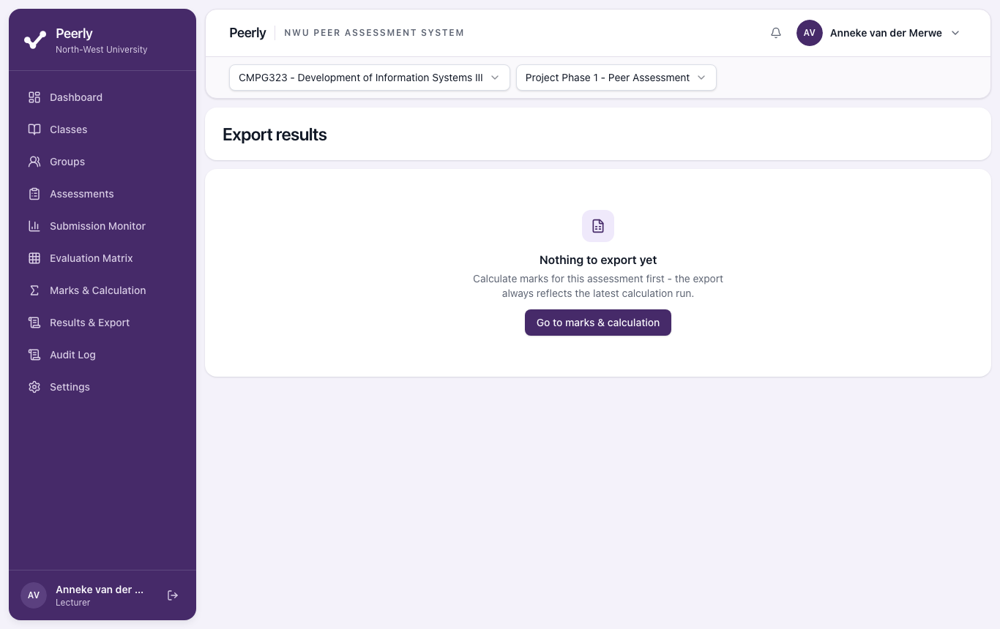

The workbook is named like `peerly-cmpg323-project-phase-2-peer-assessment-2026-09-22.xlsx` and
has two worksheets:

| Worksheet | Contents |
| --- | --- |
| **Results** | A header block (**Class**, **Academic period**, **Assessment**, **Generated**, **Calculation run id**, **Calculated at**, **Overrides included**, **Flagged students**), then one row per student: **Student number**, **Surname**, **Name**, **Group**, **Ratings received**, **Mean received**, **Group mean**, **Adjustment factor**, **Group base mark**, **Final mark**, **Override mark**, **Override reason**, **Overridden by**, **Flags** |
| **Raw Ratings** | One row per rating: **Group**, **Evaluator number**, **Evaluator**, **Evaluated number**, **Evaluated**, **Rating**, **Scale value**, **Comment**, **Submitted at** |

- **Final mark** is always the calculated mark. Where you overrode a mark, use **Override mark**
  for that student.
- You can only export after calculating: *"Calculate the marks before exporting, so there is
  something to export."*
- Exporting is recorded in the audit log. Students never see this file.
- Keep the exported file. Peerly warns you before deleting results that were never exported (see
  [section 15](#15-deleting-a-class-or-an-assessment)).

---

## 14. Audit log

**Audit Log** lists everything that has happened in the **active class**: who did it, when, and
what it affected. Entries can't be edited or deleted by anyone.

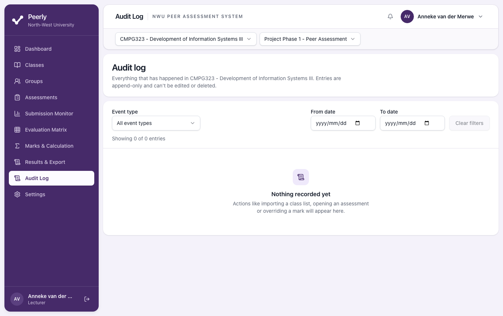

- Filter by **Event type**, **From date** and **To date**, then use **Clear filters** to reset.
- The events you'll see: *Class created*, *Class list imported*, *Match conflict resolved*,
  *Groups confirmed*, *Assessment created*, *Assessment changed*, *Assessment opened*,
  *Assessment closed*, *Assessment re-opened*, *Group mark entered*, *Marks calculated*, *Mark
  overridden*, *Results exported*, *Assessment deleted* and *Class deleted*.

---

## 15. Deleting a class or an assessment

Both actions are in a separate **danger zone** at the bottom of the page, and both are
permanent.

- **Delete assessment** (on the assessment page): removes it with every submission, rating,
  comment, base mark and calculated result. Students no longer see it.
- **Delete class** (on **Classes**): removes the class, its class list, groups and every
  assessment in it, with all ratings and marks.

1. Select the delete button. The confirmation names exactly what will be removed.
2. **If the results were never exported**, you must also tick *"…ratings and marks were never
   exported. I understand they can't be recovered once deleted."* The delete button stays
   disabled until you do.
3. Select **Delete assessment** or **Delete class**.

The audit log records that the item was deleted and by whom, but none of its data. **Export
first.**

---

## 16. Messages you might see and what they mean

| Message | Meaning | What to do |
| --- | --- | --- |
| *A module code is 4 letters and 3 digits, for example CMPG323.* | Invalid module code. | Correct it. |
| *[code] already exists for [period]…* | You already have that class for that period. | Use a different code or period, or use the existing class. |
| *Peerly can't read the older .xls format…* | The file is `.xls`. | Save as `.xlsx` or `.csv`. |
| *That file is larger than 5 MB…* / *…has more than 2000 rows. Please split it.* | The file is too big. | Split or trim the file. |
| *That file is empty.* / *That file has no column headings.* | Nothing to read. | Check you exported the right file, with headings in row 1. |
| *"[heading]" is mapped to more than one field.* | The same column is chosen twice. | Choose a different column for one of the fields. |
| *There are no valid rows to import.* | Every row has an error. | Fix the file and upload it again. |
| *There are only N matched students in this class…* | You asked for more groups (or a bigger group size) than there are matched students. | Enter a smaller number, or match more students first. |
| *"[assessment]" already has submissions, so the groups it was set up with can't be changed.* | Regrouping is blocked. | See [5.4](#54-when-groups-are-locked). |
| *Groups can't be changed once an assessment has opened…* | You changed the groups of an opened assessment. Shown on screen as *We couldn't save this assessment*. | Put the groups back as they were, or create a new assessment. |
| *The closing time has to be after the opening time.* | Invalid dates. | Fix the dates. |
| *Only a draft assessment can be opened.* / *Only an open assessment can be closed.* / *Only a closed assessment can be re-opened.* | Someone else (or another tab) changed the status. | Refresh the page. |
| *Enter a mark between 0 and [max].* / *This assessment is out of [max], so the mark can't be higher.* | The mark is out of range. | Correct it. |
| *Use whole numbers or one decimal place, e.g. 74.5.* | Too many decimals in a base mark. | Round to one decimal. |
| *N group(s) still have no mark…* | Calculation was refused. | Enter every group's base mark. |
| *This assessment hasn't opened yet, so there is nothing to calculate.* | The assessment is still a draft. | Open it and collect ratings first. |
| *Give a reason for the override.* | The reason is empty. | Explain the override. |
| *This student has no calculated mark to override yet.* | No calculation has been run. | Calculate first. |
| *Calculate the marks before exporting…* | Export with no results. | Calculate first. |
| *We couldn't find that, or you don't have access to it.* | The item doesn't exist, or belongs to another lecturer. | Check the class and assessment selectors. |
| *Your session has ended. Please sign in again.* | You were signed out for inactivity. | Refresh and sign in. |
| *Something went wrong on our end. Please try again.* | Unexpected error. The details are logged for support. | Try again. If it keeps happening, report it with the time. |

---

## 17. Known limitations in the current version

These are known gaps in the build this guide was written against. Work around them as described.

1. **Provisional marks (AS-08).** See the note at the top.
2. **No automatic opening or closing.** You have to open and close each assessment yourself
   ([6.2](#62-the-assessment-page)).
3. **Reminders aren't sent.** **Send reminder** shows a confirmation, but no email goes out.
4. **Regrouping removes groups from existing assessments** that have no submissions yet,
   including open ones ([5.3](#53-confirm)).
5. **The column step always mentions a "Programme" column** being ignored, whatever your file
    contains. You can ignore that note.

---

## 18. Frequently asked questions

**Can students see the numbers behind the labels, or their adjustment factor?**
No. Students only ever see the descriptive labels. Values, factors and marks never reach the
Student Portal.

**Can a System Administrator see my students' ratings or marks?**
No. Administrators manage staff accounts only. They can read the audit log, but not ratings or
marks.

**Can another lecturer see my classes?**
No. Every class and assessment belongs to the lecturer who created it. Another lecturer gets
*"We couldn't find that, or you don't have access to it."*

**A student says they submitted, but the monitor says they haven't.**
The monitor only counts evaluations that were **submitted**. A student who selected **Save and
finish later** hasn't submitted. Ask them to open the assessment, **Review your ratings**, and
**Submit evaluation**.

**A student's group mate left the module. What happens to the ratings?**
If the student is still in the group, they appear in the results (probably as **Did not
submit**). Groups can't be changed once submissions exist, so use an override with a reason if
the result is unfair.

**Can I change a mark after exporting?**
Yes. Override it, then export again. Each export records the calculation run id, so you can
tell exports apart.

**Should I calculate before closing the assessment?**
No. Close it first so the ratings can't change. If you re-open after calculating, the results
are invalidated and you'll need to calculate again.

**Who do I contact about my account?**
A System Administrator (for example, to change your name or email, or if you're locked out of
activation).
