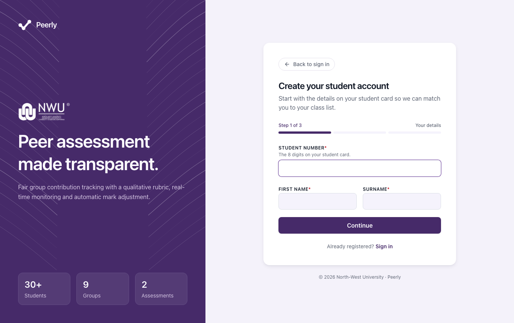
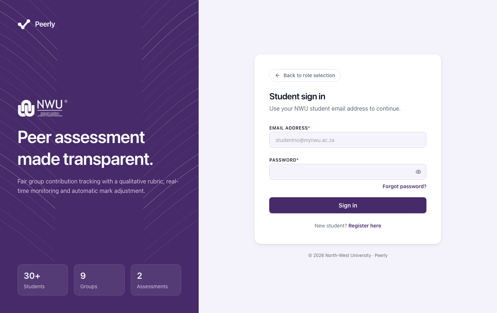
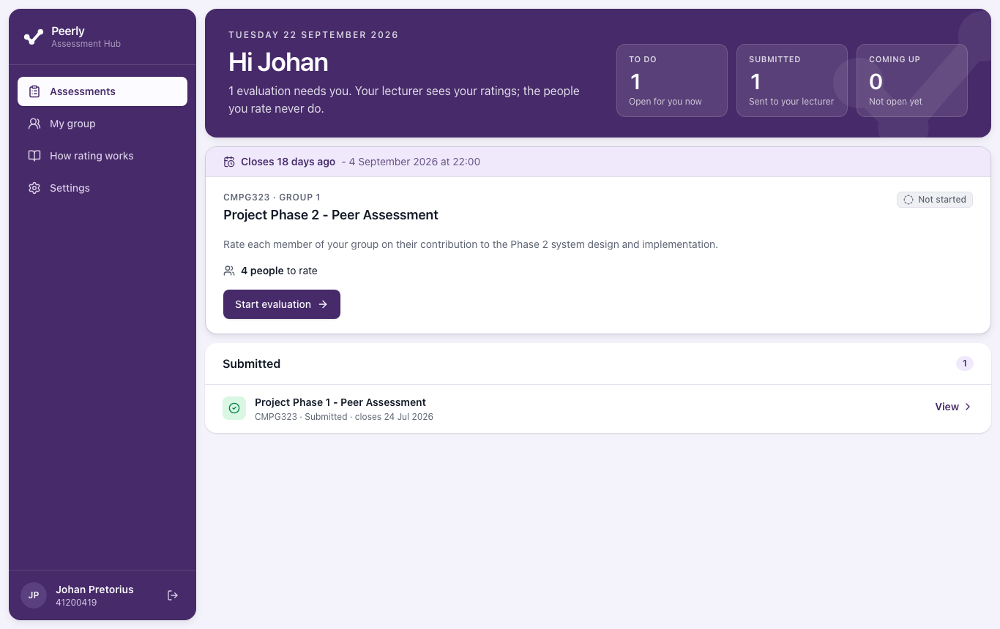
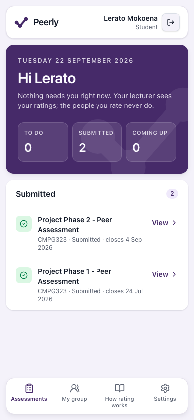
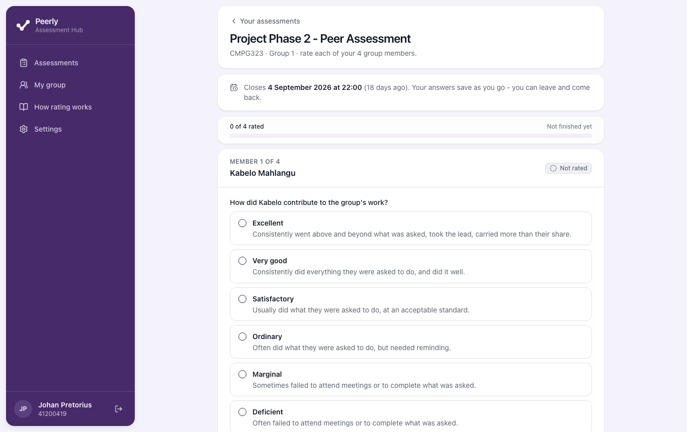
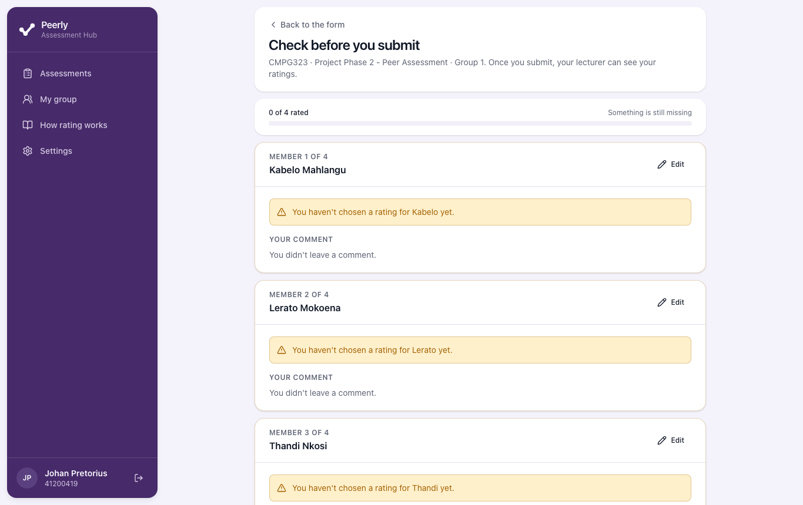
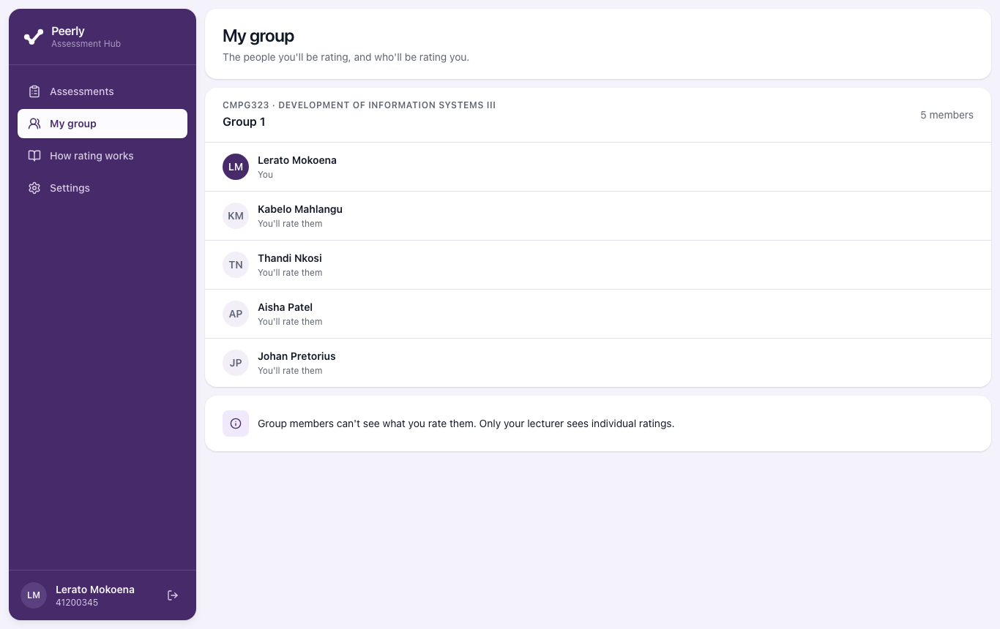
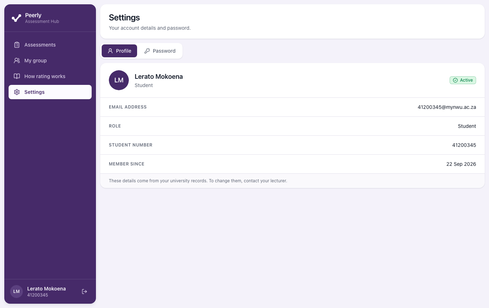
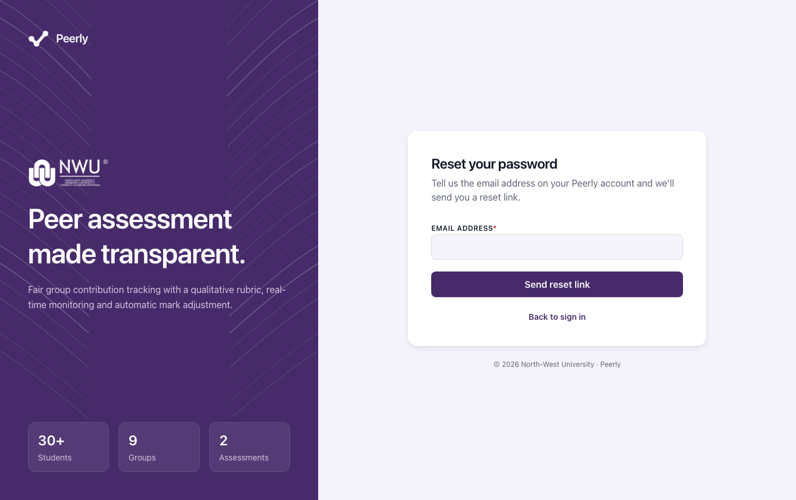
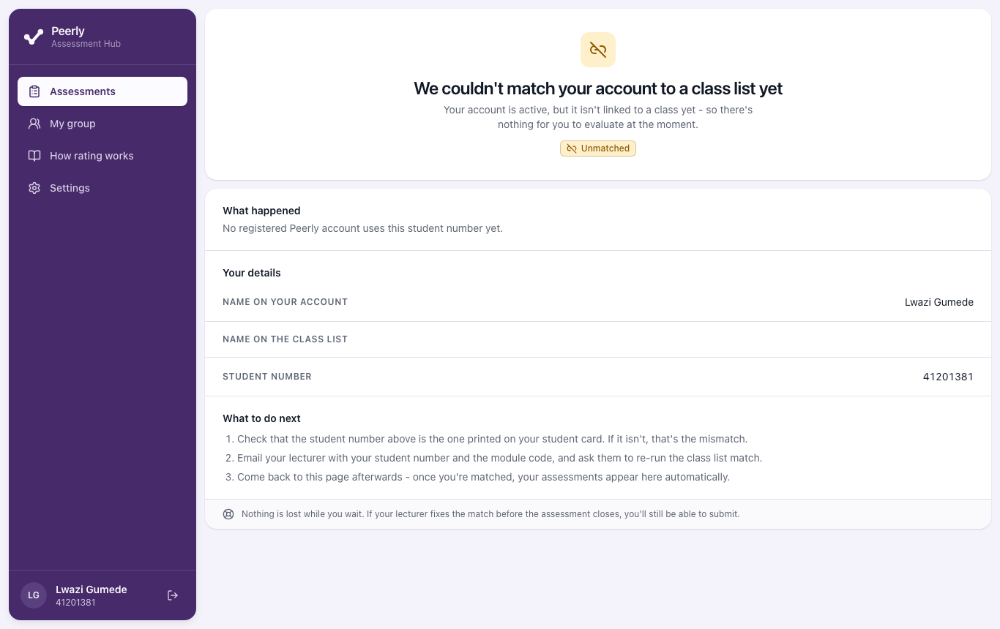

# Peerly Student Guide

**Peer assessment for NWU group projects**

| | |
| --- | --- |
| Audience | Students at North-West University whose lecturer uses Peerly |
| Covers | Registering, signing in, rating your group, checking and submitting, fixing problems |
| Requirement | OR-25 (electronic user guide: Student) |

---

## Contents

1. [What Peerly is](#1-what-peerly-is)
2. [What you need](#2-what-you-need)
3. [Create your account](#3-create-your-account)
4. [Sign in and sign out](#4-sign-in-and-sign-out)
5. [Your Assessments page](#5-your-assessments-page)
6. [Rate your group](#6-rate-your-group)
7. [Check and submit](#7-check-and-submit)
8. [Change your answers after submitting](#8-change-your-answers-after-submitting)
9. [The other pages: My group, How rating works, Settings](#9-the-other-pages)
10. [Forgot your password](#10-forgot-your-password)
11. [If your account isn't linked to a class](#11-if-your-account-isnt-linked-to-a-class)
12. [Messages you might see and what they mean](#12-messages-you-might-see-and-what-they-mean)
13. [Things to know about the current version](#13-things-to-know-about-the-current-version)
14. [Frequently asked questions](#14-frequently-asked-questions)

> The screenshots in this guide come from a test system with made-up students. Your screens show
> your own name, modules and group members.

---

## 1. What Peerly is

Your lecturer uses Peerly after a group project. It asks you to describe how each of your group
members contributed.

- **You rate each member of your group.** You don't rate yourself.
- **You choose a phrase, not a number.** Every option is a short description of what the person
  did, such as *"Usually did what they were asked to do, at an acceptable standard."*
- **Only your lecturer sees your ratings.** The people you rate never see what you chose for
  them, and you never see what they chose for you.
- **Your ratings affect marks.** Your lecturer gives the group one mark for the work. Peerly then
  adjusts it for each person, based on how their group rated them. Your lecturer checks the
  result and can change a mark if there's a good reason.

---

## 2. What you need

- **Your student number.** This is the 8 digits on your student card, for example `41200345`.
- **Your NWU student email address.** It ends in `@mynwu.ac.za`. You can't use a personal
  address such as Gmail.
- **A web browser** on a computer, tablet or phone. Current versions of Chrome, Edge, Firefox
  and Safari all work. You don't need to install anything.

Peerly links your account to your lecturer's class list by **student number**. Use exactly the
number on your student card. Your student email address is that same number followed by
`@mynwu.ac.za` (for example `41200345@mynwu.ac.za`), and Peerly checks that the two match.

---

## 3. Create your account

You only do this once. It takes three short steps.

1. Open Peerly. On the **Welcome to Peerly** page, choose **I'm a student**, then **Continue**.

   

2. On **Student sign in**, select **Register here** (below the form, next to *New student?*).

### Step 1 of 3: Your details

3. Enter your **Student number** (8 digits), your **First name** and your **Surname**.
4. Select **Continue**.

### Step 2 of 3: Account

5. Enter your **Student email**. It must end in `@mynwu.ac.za`, and the part before the `@` must
   be the student number you entered in step 1. If they don't match, Peerly says *"This isn't
   the address for student number …"*, shows the address that goes with your number, and won't
   create the account.
6. Choose a **Password** and type it again in **Confirm password**. Your password must:
   - be at least 8 characters long
   - not be a commonly used password, such as `password123`
   - not contain your email address or your student number
7. Read the data notice and tick **I understand what data is collected and why**. The notice
   says that Peerly stores your name, student number and university email so your lecturer can
   match you to a class list and a group. Your lecturer sees the ratings you give, but the
   students you rate never do. Your data is kept while the module runs and deleted once results
   are finalised.
8. Select **Create account**.

### Step 3 of 3: Verify email

9. Peerly emails a **6-digit code** to your student address. The subject line starts with the
   code, for example *"123456 is your Peerly verification code"*.
10. Type the code into the six boxes. Peerly checks it as soon as you enter the last digit, so
    you don't have to press anything. You can also select **Verify email**.
11. When you see **You're all set**, your account is active and you're already signed in. Select
    **Go to your dashboard**.

**Good to know**

- The code **expires after 10 minutes**, and you can get it wrong **5 times** before it stops
  working. If either happens, select **Resend code** to get a new one. The link is available 30
  seconds after the last code was sent (until then you'll see *Resend in …s*).
- Can't find the email? Check your junk folder. University mail filters are strict.
- Made a mistake in your details? Select **Back**. Your account is saved but not verified yet,
  so you can correct your details and select **Save and resend code**. The new code goes to the
  corrected address.

---

## 4. Sign in and sign out

### Sign in

1. Open Peerly, choose **I'm a student**, then **Continue**.
2. Enter your **Email address** and **Password**.
3. Select **Sign in**.

If the details are wrong you'll see *"Those details don't match an active Peerly account. Please
check and try again."* For security, Peerly gives this same message whatever the problem is: a
mistyped address, a wrong password, an account that isn't verified yet, or an account that is
locked (see below).

The student sign-in only accepts student accounts. If a lecturer or administrator account signs
in here, Peerly says which sign-in to use instead and doesn't sign them in.

**Locked out?** After **5 wrong passwords in a row**, your account is locked for **15 minutes**.
Each further attempt during that time keeps it locked, so stop and wait for the full 15 minutes.
If you've forgotten your password, [reset it](#10-forgot-your-password) instead.

### Sign out

- **On a computer:** select the sign-out icon next to your name, at the bottom of the left-hand
  menu.
- **On a phone:** select the sign-out icon at the top right of the screen.

**Automatic sign-out.** Peerly signs you out after **30 minutes without activity**, and after
**12 hours** in any case. If pages stop loading, refresh the page and sign in again. Answers
you've already chosen are not lost (see [Saving as you go](#saving-as-you-go)).

---

## 5. Your Assessments page

After you sign in, you land on **Assessments**. The top of the page says whether anything needs
you, with three counts:

- **To do**: open for you now
- **Submitted**: sent to your lecturer
- **Coming up**: not open yet

Anything you need to act on appears as a large card. The card shows:

- the deadline, highlighted when it's less than three days away (for example *Closes in 2 days*)
- the module code and your group number
- the assessment name and your lecturer's description
- how many people you have to rate
- a **Start evaluation** button, or **Continue evaluation** if you've already started

Everything else is grouped below the cards:

| Section | What it means |
| --- | --- |
| **Submitted** | You've submitted. Select **View** to see what you sent. |
| **Coming up** | Your lecturer has published it, but its opening time hasn't arrived yet. It shows when it opens, and you can start rating from then. |
| **Closed** | It closed and you didn't submit (*"you didn't submit"*). You can't submit now. |

Each assessment also carries a status label:

| Label | Meaning |
| --- | --- |
| **Not yet open** | Your lecturer hasn't opened it yet. |
| **Not started** | It's open and you haven't rated anyone yet. |
| **In progress** | It's open and you've started but haven't submitted. |
| **Submitted** | Your lecturer has your ratings. |
| **Closed - not submitted** | It closed before you submitted. |

If nothing has been set up for you yet, the page says **No assessments yet**.

On a phone, the menu is at the bottom of the screen: **Assessments**, **My group**, **How rating
works** and **Settings**.

---

## 6. Rate your group

1. On **Assessments**, select **Start evaluation** (or **Continue evaluation**).
2. The top of the form shows the closing date and time, and a progress bar such as **0 of 4
   rated**. The progress bar stays at the top of the screen while you scroll.

   

3. Each group member has their own panel, headed *Member 1 of 4* and so on. Under **How did
   [name] contribute to the group's work?**, select the **one** option that best describes
   what the person actually did.
4. Optionally, write a **Comment about [name]** (up to 500 characters). Use it for anything your
   lecturer should know about how the person worked with the group. Only your lecturer sees
   comments. The person you're commenting on never sees them.
5. Repeat for every member. The label beside each name changes from **Not rated** to **Rated**.
6. When the bar says **All members rated**, select **Review your ratings**.

If you want to stop partway, select **Save and finish later**.

### The nine options

Options are listed from strongest to weakest. Choose the one that matches what the person did,
not the one that feels kindest.

| Option | What it means |
| --- | --- |
| **Excellent** | Consistently went above and beyond what was asked, took the lead, carried more than their share. |
| **Very good** | Consistently did everything they were asked to do, and did it well. |
| **Satisfactory** | Usually did what they were asked to do, at an acceptable standard. |
| **Ordinary** | Often did what they were asked to do, but needed reminding. |
| **Marginal** | Sometimes failed to attend meetings or to complete what was asked. |
| **Deficient** | Often failed to attend meetings or to complete what was asked. |
| **Unsatisfactory** | Consistently failed to attend meetings or to complete what was asked. |
| **Superficial** | Contributed practically nothing to the work of the group. |
| **No contribution** | Never attended and contributed nothing at all. |

**Rate fairly.** A friend who did little should still get the option that says so. If you give
everyone the same option, your lecturer can see that, and it tells them nothing about who did
what.

### Saving as you go

Peerly saves every choice and comment as you make it. The form briefly shows **Saved** or
**Draft saved**. You can close the page and come back later. Your answers will be there and the
card will say **Continue evaluation**.

> Your unfinished answers are saved to your Peerly account as you go, so you can start on your
> phone and finish on a laptop. They count only when you **submit**. Your lecturer can see that
> you've started, but not your ratings, until you submit.

---

## 7. Check and submit

After **Review your ratings** you see **Check before you submit**. It repeats every choice in the
same words you picked, with your comment underneath.

1. Read through each member.
   - To change one, select **Edit** next to that person's name. This takes you back to their
     panel on the form.
   - If someone hasn't been rated, their panel says *You haven't chosen a rating for [name] yet*.
2. When the bar says **Ready to submit**, select **Submit evaluation**.
3. Peerly shows **Your evaluation has been submitted**, with:
   - **Submitted at**: the date and time
   - **Group members rated**, for example *4 of 4*
   - **Comments left**: how many comments you wrote
   - the option you chose for each person, and your comments

**You can't submit until everyone is rated.** If you try, Peerly lists the people you missed:
*"You haven't rated [names] yet. Every group member needs a rating before you can submit."*

---

## 8. Change your answers after submitting

You can change your answers **until the assessment closes**, which happens at the closing time
shown, or earlier if your lecturer closes it.

1. On **Assessments**, find the assessment under **Submitted** and select **View**.
2. On the confirmation page, select **Amend your evaluation**.
3. Change what you need, then **Review your ratings** and **Submit evaluation** again. Your new
   answers replace the old ones. Nothing is added twice.

Once the assessment closes, the confirmation page says *"This assessment closed on …, so your
submission is final."* After that, nobody can change it, including you.

---

## 9. The other pages

### My group

Shows your group for each module: your name at the top, then everyone you'll rate, marked
**You'll rate them**. At the bottom: *"Group members can't see what you rate them. Only your
lecturer sees individual ratings."*

If it says **You're not in a group yet**, your lecturer hasn't put you in a group, or hasn't set
up an assessment for your group yet.

### How rating works

A short explanation you can read at any time:

- **Nobody you rate ever sees it.**
- **Describe what happened, not how you feel.**
- **It affects marks, including yours.**

It also lists **The nine options** with their descriptions, the same ones as on the form.

### Settings

- **Profile** shows your name, email address, role, student number and the date you joined.
  You can't edit these yourself. If something is wrong, contact your lecturer.
- **Password** lets you change your password. Enter your **Current password**, then a **New
  password** twice, and select **Change password**. A checklist shows the password rules as you
  type. Changing your password signs you out on every other device.

---

## 10. Forgot your password

1. On **Student sign in**, select **Forgot password?**
2. Enter the email address you registered with and select **Send reset link**.
3. Peerly shows **Check your email**. For privacy, it says the same thing whether or not an
   account exists for that address.
4. Open the email **Reset your Peerly password** and use the link within **one hour**.
5. On **Choose a new password**, enter your **New password** twice and select **Save new
   password**.
6. When you see **Password changed**, select **Go to sign in**.

If the link is too old or has already been used, you'll see **This reset link has expired**.
Select **Request a new link** and start again. Resetting your password signs you out everywhere
else.

---

## 11. If your account isn't linked to a class

When you sign in, Peerly checks your student number against your lecturers' class lists. If
one of them can't be linked to your account, the dashboard tells you which module it is and what
to do. Assessments from your other modules still show as normal. Only when nothing is linked at
all do you see a full-page explanation instead of the dashboard.

| Heading | What it means |
| --- | --- |
| **You're not on a class list yet** | No class list in Peerly has your student number yet. Your lecturer adds it when they import their class list. |
| **You're not linked to the ... class list yet** (*Unmatched*) | The module's class list has your number, but it isn't linked to your account yet. |
| **Your ... class list entry needs checking** (*Conflict*) | Your number is on the list, but the name doesn't agree, so your lecturer has to confirm it's you. |

For a module with a problem, Peerly shows the module, the name on your account, the name on the
class list and your student number, and **What to do next**:

1. Compare the details with your student card, so you can tell your lecturer what is different.
2. Email your lecturer your **student number** and the **module code** (both are shown), and
   ask them to fix the class list match.
3. Come back afterwards. Once you're linked, your assessments appear automatically.

Nothing is lost while you wait. If your lecturer fixes the match before the assessment closes,
you can still submit.

> **Registered late?** That's fine. When you verify your account, Peerly links you to any class
> list that already has your student number and name. If it still can't, tell your lecturer.

---

## 12. Messages you might see and what they mean

| Message | What it means | What to do |
| --- | --- | --- |
| *A student number is 8 digits, for example 41200345.* | The student number isn't 8 digits. | Check your student card. |
| *Use your student address ending in @mynwu.ac.za, not a personal one.* | You used a non-student email. | Use your `@mynwu.ac.za` address. |
| *This isn't the address for student number …* / *Your student number and student email don't match…* | The student number isn't the one in your student email address. | Use your own student number, and your student email that starts with it. |
| *An account already uses that student number.* / *…that email address.* | Someone has already registered with it, perhaps you. | Try **Sign in** or **Forgot password?**. If you didn't register, tell your lecturer. |
| *That password is too common. Choose something harder to guess.* | The password is on a list of easily guessed passwords. | Choose another. |
| *Don't use your email address or student number in your password.* | The password contains your email or student number. | Choose another. |
| *The two passwords don't match.* | The two passwords you typed are different. | Type them again. |
| *Please confirm you've read what data Peerly collects before continuing.* | The data notice isn't ticked. | Read it and tick the box. |
| *That code isn't right. Check the latest email we sent and try again.* | The code is wrong, expired, or has had too many attempts. | Use the newest email, or select **Resend code**. |
| *Those details don't match an active Peerly account.* | Sign-in failed. | Check your email and password. Wait 15 minutes if you may be locked out. Verify your email if you only just registered. |
| *Too many attempts. Please wait a few minutes and try again.* | Too many attempts from your network in a short time. | Wait a few minutes. |
| *That isn't your current password.* | In **Settings**, the current password is wrong. | Retype it. |
| *Choose a password different from your current one.* | The new password is the same as the old one. | Choose a different one. |
| **This assessment isn't open yet** | Your lecturer hasn't opened it. | Come back after the opening date shown. |
| **This assessment has closed** | The closing time has passed, or your lecturer closed it. You can no longer submit or change your answers. | Speak to your lecturer if you think this is a mistake. |
| **We couldn't find that assessment** | It was removed, or it's for a group you're not in. | Go **Back to your assessments**. |
| *We couldn't submit your evaluation. Your ratings are saved - please try again.* | The submission didn't reach Peerly, for example because the connection dropped. | Check your connection and select **Submit evaluation** again. Your answers are still there. |
| *There's nobody else in your group to rate.* | You're the only person in your group. | Tell your lecturer. |

---

## 13. Things to know about the current version

These are known limits of the current version. They don't affect your privacy or your marks.

- **Changing a submitted evaluation on two devices.** If you choose to change your answers,
  finish and submit again on the same device: the changes stay on that device until you do.
  Until you resubmit, your earlier submission is the one that counts, and the dashboard still
  lists it as **Submitted**, with *"your changes aren't sent yet"*.
- **Reminders.** Your lecturer can email a reminder to anyone who hasn't submitted, but don't
  wait for one - keep an eye on your deadlines yourself.
- **Closing times.** An assessment closes at the closing time shown, even if your lecturer hasn't
  closed it yet. From then on the form can't be changed or submitted, so submit before then. Only your lecturer can extend it.

---

## 14. Frequently asked questions

**Can the people in my group see what I said about them?**
No. Only your lecturer sees individual ratings and comments. Group members never see them.

**Can I see what my group said about me, or my adjusted mark?**
No. Peerly never shows students other people's ratings, and your lecturer publishes marks
through the normal university channels.

**Do I rate myself?**
No. You rate everyone in your group except yourself.

**Why are there no numbers or stars?**
Descriptions are fairer and clearer than a score out of five. You describe what happened, and
your lecturer's side of Peerly works out the rest.

**What if I didn't submit before the deadline?**
Your group members' ratings of you still count. Your lecturer will see that you didn't submit.
Whether that has other consequences is up to your lecturer and module rules.

**I'm in the wrong group, or someone is missing from my group.**
Contact your lecturer. Only they can change groups, and usually only before anyone has
submitted.

**My name or student number is wrong.**
You can't edit your own details. Contact your lecturer.

**I closed the page before entering my verification code.**
Register again with the same student number and email. Peerly continues your unfinished
registration and sends you a new code. It doesn't complain that the account already exists.

**Can I use my phone?**
Yes. Every page works on a phone screen. Your unfinished answers are saved to your Peerly
account as you go, so you can start on your phone and finish on a laptop. The one exception is
changing an evaluation you've already submitted: finish that on the same device.

**Who do I contact about Peerly?**
Your lecturer, for anything about your class, group or assessment.
